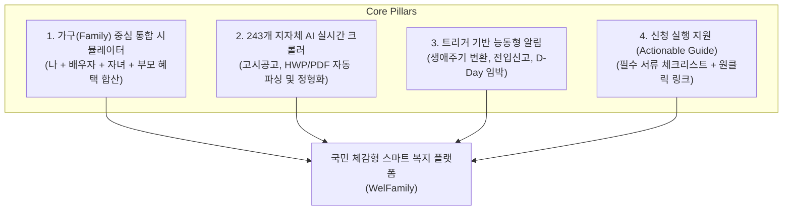

# 01. 유사 서비스 분석 및 시장 벤치마킹 보고서 (Market & Competitor Analysis)

## 1. 시장 배경 및 문제 정의 (Market Background & Problem Statement)

### 1.1 시장 배경
- **국가 복지 예산의 폭발적 증가**: 대한민국 정부 및 지자체의 사회복지 예산은 연간 200조 원을 돌파하였으며, 중앙부처 복지사업 약 360여 개, 전국 243개 지자체 자체 복지사업은 약 1만 개 이상에 달합니다.
- **복지 사각지대의 역설 (The Paradox of Welfare Divide)**: 예산과 정책은 매년 늘어나고 있으나, 국민들은 **"내가 받을 수 있는 복지가 무엇인지 몰라서", "신청 방법이 너무 어렵고 복잡해서", "신청 시기를 놓쳐서"** 혜택을 받지 못하는 만성적인 정보 비대칭에 직면해 있습니다.
- **지자체별 복지 격차 심화**: 중앙부처 공통 복지(아동수당, 기초연금 등) 외에, 지자체별로 지원하는 출산장려금, 청년월세, 농어민수당, 난임시술비, 어르신 교통비 등은 거주하는 시·군·구에 따라 지원액과 자격 조건이 천차만별입니다.

### 1.2 핵심 문제점 (Core Pain Points)
1. **공공 정보의 극심한 파편화**: 중앙부처는 '복지로', 지자체는 각 시군구청 홈페이지 고시/공고 게시판(HWP/PDF 문서 형태), 공공기관은 개별 웹사이트에 산재되어 있습니다.
2. **난해한 행정 언어와 복잡한 자격 산정**: '기준 중위소득 150%', '소득인정액', '부양의무자 기준', '재산의 소득환산율' 등 일반인이 스스로 수혜 자격을 계산하기 불가능에 가깝습니다.
3. **수동적·사후적 알림 체계**: 대부분의 복지제도는 '신청주의'를 채택하고 있어 신청하지 않으면 지급되지 않으나, 정부 알림은 연 1~2회 정기 안내에 그치거나 마감 기한이 임박한 단기 사업을 제때 알려주지 못합니다.
4. **개인 중심의 조회 한계 (가구 시너지 누락)**: 복지 혜택의 상당수는 '가구원 수, 가구 합산 소득'에 기반하여 판정되나, 기존 서비스들은 로그인한 개인 한 명의 자격만 조회하는 경우가 많아 부모, 자녀, 배우자가 결합된 가구 전체의 수혜액을 계산하지 못합니다.

---

## 2. 유사 서비스 벤치마킹 (Competitor Analysis)

현재 국내에서 복지/지원금 정보를 제공하는 대표적인 4가지 유형의 서비스를 심층 분석하였습니다.

```
                    [공공성 / 공식 신뢰도]
                              ▲
                              │     [복지로 (복지멤버십)]
                              │     [보조금24 (정부24)]
                              │
[기능 단순 / 1회성] ──────────┼────────── [초개인화 / 능동형 알림]
                              │
                              │     ★ WelFamily (우리 서비스 목표)
                              │     [웰로 (Wello)]
                              │
                    [토스 / 뱅크샐러드]
                              │
                              ▼
                     [민간 상업 / 핀테크]
```

### 2.1 주요 경쟁/유사 서비스 상세 분석

| 구분 | 1. 복지로 (맞춤형 급여안내) | 2. 보조금24 (행정안전부) | 3. 웰로 (Wello) | 4. 토스 (숨은 정부지원금 찾기) |
| :--- | :--- | :--- | :--- | :--- |
| **운영 주체** | 보건복지부 / 사회보장정보원 | 행정안전부 (정부24) | 민간 스타트업 ((주)웰로) | 토스 (비바리퍼블리카) |
| **주요 타깃** | 전 국민 (취약계층/수급자 중심) | 정부24 이용 국민 | 청년, 부모, 스타트업/기업 | 토스 앱 이용 금융 소비자 |
| **데이터 범위** | 중앙부처 복지사업 80여 개 중심, 주요 지자체 공통 사업 | 중앙부처 + 지자체 공공서비스 연계 데이터 | 중앙부처 + 243개 지자체 + 민간 장학재단 등 | 공공데이터포털 연동 주요 대중적 지원금 |
| **매칭 방식** | 공적 장부(건보료 등) 기반 사전 모의 판정 | 주민등록 전산망 및 행정망 매칭 | 사용자 프로필 설문 + NLP 키워드 매칭 | 간이 설문(나이, 가구, 직업, 소득구간) 매칭 |
| **알림 방식** | 카카오 알림톡/문자 (연 1~2회 정기 안내 및 시스템 변경 시) | 정부24 앱 푸시, 국민비서(구삐) 연동 | 앱 푸시, 주간 맞춤 정책 레터 | 앱 푸시 (금융/혜택 탭 유입 목적) |
| **핵심 강점** | - 국가 공식 행정 데이터 기반<br>- 신뢰도 최상<br>- 직권 심사 데이터 연계 | - 정부24 원스톱 온라인 신청 연계<br>- 가족관계등록부 연동 동의 시 가족 조회 가능 | - 지자체 비정형 공고 스크래핑/정제<br>- 타임라인 기반 생애주기 UI<br>- 직관적인 민간 UX | - 압도적인 접근성 및 간편한 UX<br>- 1분 내 빠른 조회<br>- 토스 금융 생태계 연계 |
| **한계점 (Pain Points)** | - 지자체 특화 신규 사업 대거 누락<br>- "받을 수 있는 복지가 없습니다" 등 피로감 유발<br>- 신청 절차는 결국 오프라인 방문 다수 | - 실시간 신규 정책 알림 부족<br>- 조건이 까다로운 세부 기준(조례) 반영 미흡<br>- 공공 웹 특유의 무거운 UI | - B2B(웰로비즈) 피벗으로 B2C 가족 케어 기능 정체<br>- 가구 단위 복합 소득/조건 시뮬레이션 부족<br>- 서류 준비 자동화 미비 | - 깊이 있는 지자체 정책 부족<br>- 금융 상품 가입 유도를 위한 마케팅 도구로 활용<br>- 실질적 신청 후속 관리 부재 |

---

## 3. 심층 사용자 VoC 및 시장 공백 (White Space)

기존 서비스들의 사용자 리뷰, 복지 커뮤니티(맘카페, 청년 커뮤니티, 뽐뿌 복지포럼 등)의 불만 사항을 집계한 결과 다음과 같은 4대 공백 영역이 발견되었습니다:

```
[사용자 핵심 불만 사항 (VoC)]

1. "출산 지원금 알아보려고 구청 홈페이지 들어갔더니, 첨부파일(HWP) 열람하라고 하고 조건도 너무 헷갈려요."
   → 비정형 지자체 공고의 쉬운 요약 및 실시간 데이터화 필요

2. "정부24 보조금24에서 조회했더니 10개 나오는데, 막상 신청하려니 주민센터에서 '예산 소진'이라고 하네요."
   → 선착순/예산 마감 현황 및 접수 D-Day 실시간 추적 필요

3. "저희 부부 맞벌이 소득이랑 아이 나이, 부모님 기초연금까지 합쳐서 우리 집 전체가 받는 돈이 얼마인지 한눈에 알고 싶어요."
   → 가구(Household) 통합 대시보드 및 복지 가계부 부재

4. "신청하려고 주민센터 갔더니 '가족관계증명서 상세'랑 '건보료 납부확인서' 안 떼왔다고 다시 오라더군요."
   → 신청 전 구비서류 체크리스트 및 원클릭 발급 가이드 부재
```

---

## 4. 본 서비스의 포지셔닝 및 차별화 전략 (Unfair Advantages)

우리가 구축할 서비스 **`WelFamily (우리 가족 복지비서)`**는 기존 서비스의 한계를 극복하고 다음과 같은 4대 핵심 축을 바탕으로 시장을 혁신합니다.



### 차별화 포인트 요약:
1. **가구원 단위 결합 매칭 (Multi-Profile Matching Engine)**:
   - 개인 1인이 아닌 '우리 가족 프로필'을 생성.
   - 예: "맞벌이 부부 + 2세 자녀 + 지방 거주 노부모" 등록 시, 가구 전체에 귀속되는 영유아 지원금 + 부부 세액공제/육아휴직 + 노부모 돌봄/기초연금 혜택을 합산 계산.
2. **지자체 고시공고 AI Ingestion Pipeline**:
   - 보조금24 OpenAPI뿐만 아니라, 전국 시·군·구청 게시판에 매일 올라오는 HWP/PDF 공고문을 LLM으로 파싱하여 자격요건, 지원금액, 신청기간, 예산한도를 표준 JSON으로 변환.
3. **생애주기 트리거 캘린더 (Life-Stage Notification)**:
   - 자녀의 월령 변화(예: 12개월 돌파, 초등학교 입학, 만 8세 아동수당 종료 등), 이사(전입신고), 취업/이직 등 삶의 마일스톤에 맞춰 선제적으로 변경될 혜택을 사전 통지.
4. **신청 피로도를 0으로 만드는 실행 가이드**:
   - "어디서 신청하나요?": 온라인 접수 링크 direct 연결.
   - "주민센터 갈 때 뭘 챙겨가나요?": 스마트폰에서 바로 확인하고 체크할 수 있는 필수 서류 발급 안내(정부24 전자문서지갑 연계 안내).
