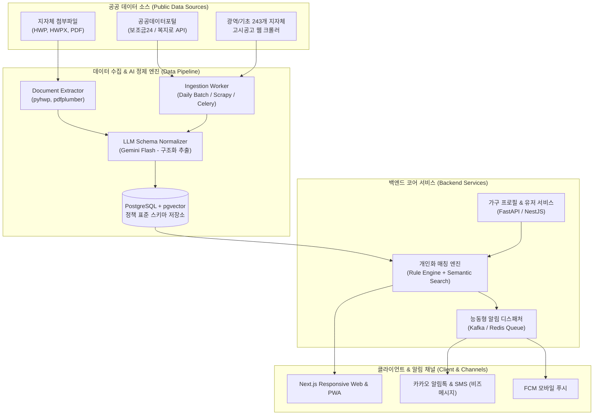
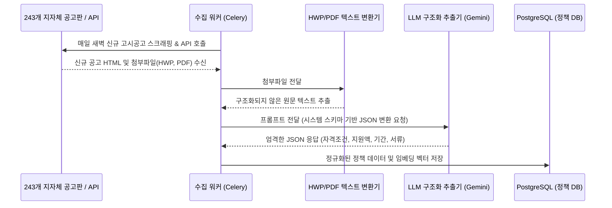
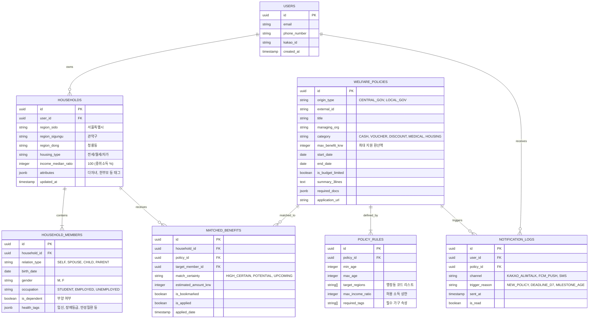

# 03. 시스템 아키텍처 및 데이터 파이프라인 설계 (System & Data Engineering)

## 1. 전체 시스템 아키텍처 (Overall Architecture)

웰패밀리(WelFamily)는 방대한 공공 데이터의 수집·정제와 초개인화된 실시간 매칭·알림을 위해 **이벤트 기반 마이크로서비스 및 파이프라인 아키텍처**로 구성됩니다.



---

## 2. 지자체 특화 데이터 파이프라인 (Data Pipeline Strategy)

대한민국 공공 복지 데이터의 가장 큰 난제는 **"지자체 공고의 비정형성(HWP 파일 배포 등)"**입니다. 본 서비스는 3단계 수집 정제 파이프라인으로 이를 자동화합니다.

### 2.1 3단계 데이터 수집 및 정제 절차



### 2.2 LLM 정책 추출 프롬프트 및 스키마 예시
지자체 공고 원문을 전달받아 아래와 같은 정규화된 JSON 스키마로 파싱합니다.

```json
{
  "policy_name": "2026년 관악구 청년 전월세 중개보수 및 이사비 지원사업",
  "category": "HOUSING",
  "managing_agency": "서울특별시 관악구 청년정책과",
  "region_code": "11620", // 행정동 코드 (서울시 관악구)
  "target_eligibility": {
    "min_age": 19,
    "max_age": 39,
    "residence_status": "관악구 전입 1년 이내",
    "income_limit_pct": 120, // 기준 중위소득 120% 이하
    "housing_type": ["RENTAL_MONTHLY", "RENTAL_JEONSE"],
    "asset_limit_krw": 200000000
  },
  "benefit_details": {
    "type": "CASH_REIMBURSEMENT",
    "amount_max_krw": 400000,
    "description": "부동산 중개보수 및 이사비 실비 최대 40만 원 생애 1회 지원"
  },
  "schedule": {
    "application_start": "2026-03-01T09:00:00Z",
    "application_end": "2026-11-30T18:00:00Z",
    "is_budget_limited": true // 예산 소진 시 조기 마감 여부
  },
  "required_documents": [
    {"name": "주민등록등본", "issuer": "정부24", "can_online": true},
    {"name": "부동산 임대차계약서 사본", "issuer": "본인 보관", "can_online": false},
    {"name": "이사비 영수증", "issuer": "이사 업체", "can_online": false}
  ],
  "application_channel": {
    "online_url": "https://youth.seoul.go.kr",
    "offline_desk": "관악구청 본관 4층 청년정책과"
  }
}
```

---

## 3. 데이터베이스 설계 (Data Model & ERD)

데이터베이스는 가구(Household) 단위의 확장성과 정책 매칭의 속도를 보장하기 위해 관계형 스키마(PostgreSQL)를 기반으로 설계됩니다.



---

## 4. 매칭 알고리즘 로직 (Matching Engine Logic)

매칭 엔진은 2단계 하이브리드 파이프라인(Rule-based Filter + Scoring Engine)으로 동작합니다.

```
[가구 데이터 입력]
       │
       ▼
[1차 필터링: 하드 룰 (Hard Conditions)]
 ├─ 거주 지역 일치 여부 (전국 공통 or 시도/시군구 코드 매칭)
 ├─ 대상 연령 범위 (가구원 중 조건 만족자 유무)
 ├─ 가구 소득/자산 상한선 필터 (기준 중위소득 초과 시 제외)
 └─ 필수 결격 사유 체크
       │
       ▼
[2차 스코어링: 매칭 확실도 판정]
 ├─ 100% 조건 충족 (조건이 단순 연령/지역인 경우) ──▶ [확실 (High)]
 ├─ 소득 증빙/서류 심사 필요 (경쟁률/선착순) ──────────▶ [유력 (Potential)]
 └─ 연령/생애주기 도래 예정 (3~6개월 이내) ─────────────▶ [예정 (Upcoming)]
       │
       ▼
[3차 가구 혜택 합산 및 우선순위 정렬]
 ├─ 가구 단위 연간 환산 지원금액(KRW) 높은 순
 └─ 신청 마감일(D-Day) 임박 순 정렬
```

---

## 5. 인프라 및 보안 설계 (Security & DevOps)

1. **개인정보 최소 수집 원칙**:
   - 주민등록번호 뒷자리는 일절 수집하지 않으며, 생년월일(YYYY-MM-DD)과 거주 동 단위 정보만 보관합니다.
   - 모든 개인정보는 AES-256으로 암호화하여 DB에 저장됩니다.
2. **트래픽 및 장애 복원력**:
   - 공공기관 복지 공고 발표 시기(매년 1~3월 신학기/추경) 트래픽 급증에 대비해 캐싱 계층(Redis)을 적극 활용합니다.
   - 외부 공공 API(data.go.kr)의 간헐적 장애에 대비하여 로컬 스냅샷 캐시를 유지하고 Circuit Breaker 패턴을 적용합니다.
