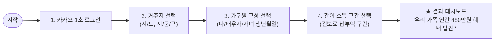
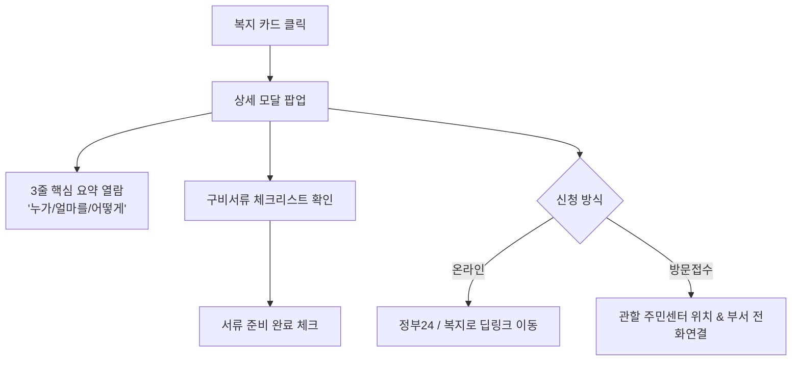
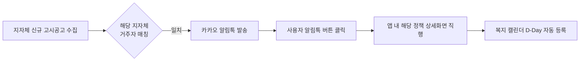

# 04. UI/UX 와이어프레임 및 사용자 플로우 (UI/UX Specification & User Flows)

## 1. 정보 구조도 (Information Architecture - IA)

모바일 퍼스트(Mobile-First) 반응형 웹/앱 환경에 최적화된 단순하고 직관적인 메뉴 구조입니다.

```
WelFamily (우리 가족 복지비서)
│
├── 1. 홈 (대시보드)
│   ├── [요약 배너] "우리 가족 연간 혜택: 총 540만 원 (미신청: 180만 원)"
│   ├── [긴급 D-Day] 마감 임박 혜택 리스트 (D-3, D-7)
│   ├── [신규 레이더] 내 거주지(시군구) 최신 등록 공고 3선
│   └── [가구원별 혜택 현황] 나 / 배우자 / 첫째 아이 / 부모님 탭
│
├── 2. 맞춤 복지 탐색 (Explorer)
│   ├── 필터 바: [전체] [현금지원] [바우처] [요금감면] [돌봄/의료] [주거]
│   ├── 발행 기관 필터: [전체] [중앙정부] [지자체 특화 ★]
│   ├── 정렬: [혜택금액 높은 순] [마감일 임박 순] [매칭 확실도 순]
│   └── 검색창 (키워드 검색)
│
├── 3. 가족 복지 캘린더 (Calendar)
│   ├── 월간 달력 뷰 (Calendar View)
│   │   ├── 파란색 핀: 정기 지원금 입금일 (매월 25일 아동수당, 기초연금 등)
│   │   └── 주황색 핀: 신청 접수 시작 / 마감 D-Day
│   └── 일자별 상세 타임라인 카드
│
├── 4. 신청 & 서류함 (Application Hub)
│   ├── 진행 중인 신청 내역
│   ├── 구비 서류 모바일 체크리스트 (정부24 연계 발급 가이드)
│   └── 찜한 복지 목록 (스크랩)
│
├── 5. 우리 가족 프로필 (Household Profile)
│   ├── 거주지 설정 (시/도, 시/군/구, 읍/면/동)
│   ├── 가구원 관리 (구성원 추가/삭제, 생년월일, 관계)
│   ├── 소득 및 주거 조건 (건보료 구간, 주택 형태)
│   └── 특성 태그 (다자녀, 신혼부부, 임신, 한부모, 장애 등)
│
└── 6. 알림 설정 (Notification Settings)
    ├── 카카오 알림톡 수신 설정 (신규 공고 즉시 알림 On/Off)
    ├── 마감 임박 D-Day 푸시 (D-7, D-3, D-Day)
    └── 주간 우리 가족 복지 다이제스트 (매주 월요일 오전 9시)
```

---

## 2. 주요 사용자 플로우 (Core User Flows)

### 2.1 온보딩 & 간편 프로필 생성 플로우 (1분 완성)
복잡한 회원가입 없이 카카오 간편로그인 후 최소 3단계 입력으로 즉시 수혜 금액을 확인합니다.



### 2.2 복지 상세 조회 및 원클릭 신청 플로우
정책을 확인하고 주민센터 헛걸음 없이 서류를 챙겨 신청하는 흐름입니다.



### 2.3 지자체 신규 공고 발생 시 능동형 알림 플로우



---

## 3. 화면별 와이어프레임 설계 (Screen Wireframes)

### 3.1 홈 대시보드 (Mobile View)

```
┌──────────────────────────────────────────────┐
│  WelFamily 웰패밀리         [서울시 관악구 ▼] 🔔 │
├──────────────────────────────────────────────┤
│  👋 김민준님 가족을 위한 맞춤 복지 레이더      │
│                                              │
│  ┌────────────────────────────────────────┐  │
│  │  우리 가족 예상 연간 혜택               │  │
│  │  💰 총 5,400,000 원                    │  │
│  │                                        │  │
│  │  [수령 중 360만원]  [미신청 180만원 !]  │  │
│  └────────────────────────────────────────┘  │
│                                              │
│  🚨 마감 임박! 놓치지 마세요                   │
│  ┌────────────────────────────────────────┐  │
│  │ [D-3] 2026 관악구 청년 이사비 지원       │  │
│  │ 혜택: 최대 40만 원 실비 지원            │  │
│  │ 대상: 관악구 전입 1인/청년 가구         │  │
│  └────────────────────────────────────────┘  │
│                                              │
│  🏷️ 우리 가족 구성원별 혜택                   │
│  [전체 8건]  [김민준(본인)]  [자녀(14개월)]   │
│                                              │
│  ┌────────────────────────────────────────┐  │
│  │ [지자체특화] 서울형 가사돌봄 서비스      │  │
│  │ 지원: 연 10회 가사도우미 무료 지원      │  │
│  │ 매칭확실도: 95% (영유아 양육 맞벌이)    │  │
│  │ [자세히 보기]            [신청 가이드] │  │
│  └────────────────────────────────────────┘  │
│  ┌────────────────────────────────────────┐  │
│  │ [중앙부처] 만 1세 부모급여 (월 50만원)   │  │
│  │ 지원: 매월 25일 계좌 입금               │  │
│  │ 상태: 현재 수령 중 (다음 입금일 11/25) │  │
│  └────────────────────────────────────────┘  │
├──────────────────────────────────────────────┤
│   [🏠 홈]   [🔍 복지탐색]   [📅 캘린더]   [👤 가족]  │
└──────────────────────────────────────────────┘
```

### 3.2 복지 상세 팝업 & 구비 서류 가이드 (Mobile View)

```
┌──────────────────────────────────────────────┐
│  < 뒤로가기                 [공유하기]  [★ 찜] │
├──────────────────────────────────────────────┤
│  [지자체 특화] 서울특별시 관악구              │
│  2026 청년·신혼부부 전월세 중개보수 지원     │
│  ──────────────────────────────────────────  │
│  📌 3줄 핵심 요약                            │
│  • 지원 대상: 관악구 전입 신혼부부/청년 가구 │
│  • 지원 내용: 부동산 중개수수료 최대 40만원  │
│  • 신청 기한: 2026. 11. 30까지 (예산 소진 시)│
│                                              │
│  📋 신청 전 필수 서류 체크리스트             │
│  [x] 주민등록등본 (정부24 즉시 무료 발급 가능) │
│      └─ [정부24 바로가기 링크]               │
│  [ ] 부동산 임대차계약서 사본                │
│  [ ] 중개보수 영수증 (공인중개사 날인 필수)   │
│  [ ] 통장 사본                               │
│                                              │
│  📍 접수처 및 문의                           │
│  • 온라인: 서울청년몽땅정보통 접수          │
│  • 오프라인: 관악구청 본관 청년정책과        │
│  • 문의전화: 02-879-5931 [전화 걸기]         │
│                                              │
│  ┌────────────────────────────────────────┐  │
│  │          [온라인 신청하러 가기]          │  │
│  └────────────────────────────────────────┘  │
└──────────────────────────────────────────────┘
```
