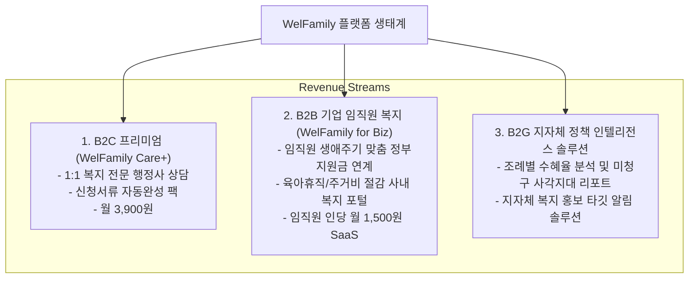

# 05. 사업화 전략, 비즈니스 모델 및 로드맵 (Business Model & MVP Roadmap)

## 1. 비즈니스 모델 (Business Model - BM)

WelFamily는 일반 국민에게는 필수적인 복지 접근성을 무료로 보장(포용적 거브테크)하면서, 기업 복지와 지자체 공공 솔루션을 통해 지속 가능한 수익을 창출하는 **B2C 프리미엄 + B2B2C / B2G 하이브리드 모델**을 구축합니다.



### 1.1 세부 수익 구조
1. **B2C (Freemium & Care+)**:
   - **Basic (무료)**: 맞춤형 혜택 조회, 기본 캘린더, 월 5건의 카카오 알림톡.
   - **WelFamily Care+ (월 3,900원 / 연 39,000원)**:
     - 실시간 선착순 공고 0초 즉시 푸시 알림.
     - 정부24 연계 필수 구비서류 일괄 PDF 압축 패키지 생성.
     - 복잡한 소득인정액(모의계산) 정밀 분석 및 행정사 1:1 Q&A.
2. **B2B2C (기업 복지 SaaS: WelFamily for Enterprise)**:
   - 기업이 복지 예산을 추가 투입하지 않고도 직원의 만족도를 극대화할 수 있는 복지 솔루션.
   - 직원의 결혼, 출산, 자녀 입학, 주택 마련 시 정부 지원금(부모급여, 신혼특공, 버팀목 대출 등)을 100% 챙겨받을 수 있도록 사내 인트라넷 연동.
3. **B2G (공공 데이터 분석 & 홍보 솔루션)**:
   - 지자체 담당 부서에 "지역 내 청년 중 중개보수 지원 혜택을 모르는 잠재 대상자 규모", "출산지원금 홍보 성과 지표" 등을 분석 대시보드로 제공.

---

## 2. 단계별 개발 및 출시 로드맵 (Roadmap)

```
[ Phase 1: MVP 검증 (1~3개월) ]
  • 핵심 가구 프로필 엔진 (가구원, 거주지, 소득구간)
  • 중앙부처 100대 복지 + 수도권(서울/경기/인천) 지자체 혜택 DB 구축
  • 반응형 웹 프로토타입 런칭 & 카카오 알림톡 MVP
  • 얼리어답터 5,000가구 확보 및 만족도 검증

[ Phase 2: 전국 확장 및 AI 파이프라인 완성 (4~6개월) ]
  • 전국 243개 지자체 고시공고 HWP/PDF 자동 수집 & Gemini 파싱 파이프라인
  • 우리 가족 복지 캘린더 & 가계부 연동
  • 구비서류 체크리스트 및 정부24 다이렉트 딥링크
  • iOS / Android 전용 앱 (PWA & React Native) 출시

[ Phase 3: 플랫폼 스케일업 & B2B 확장 (7~12개월) ]
  • WelFamily Care+ 유료 구독 모델 런칭
  • 기업용 'WelFamily for Biz' 파일럿 런칭 (중견/스타트업 10개 사)
  • 금융/보험 마이데이터 제휴 (소득 자동 인증 및 환산)
  • MAU 50만 돌파 및 수혜 지급액 100억 원 달성
```

---

## 3. 핵심 성과 지표 (KPIs)

| 지표 (Metric) | Phase 1 (MVP) | Phase 2 (전국 확장) | Phase 3 (성장기) |
| :--- | :--- | :--- | :--- |
| **누적 등록 가구 수** | 10,000 가구 | 100,000 가구 | 500,000 가구 |
| **알림톡 오픈율 (Open Rate)** | 55% 이상 | 65% 이상 | 70% 이상 |
| **실제 신청 전환율 (Application Rate)**| 15% | 25% | 35% |
| **가구당 평균 발굴 수혜액** | 250만 원 / 년 | 380만 원 / 년 | 480만 원 / 년 |
| **유료 구독 전환율 (Care+)** | - | 3.5% | 5.0% |
| **지자체 정책 DB 커버리지** | 수도권 500개 | 전국 5,000개 | 전국 12,000개+ |
