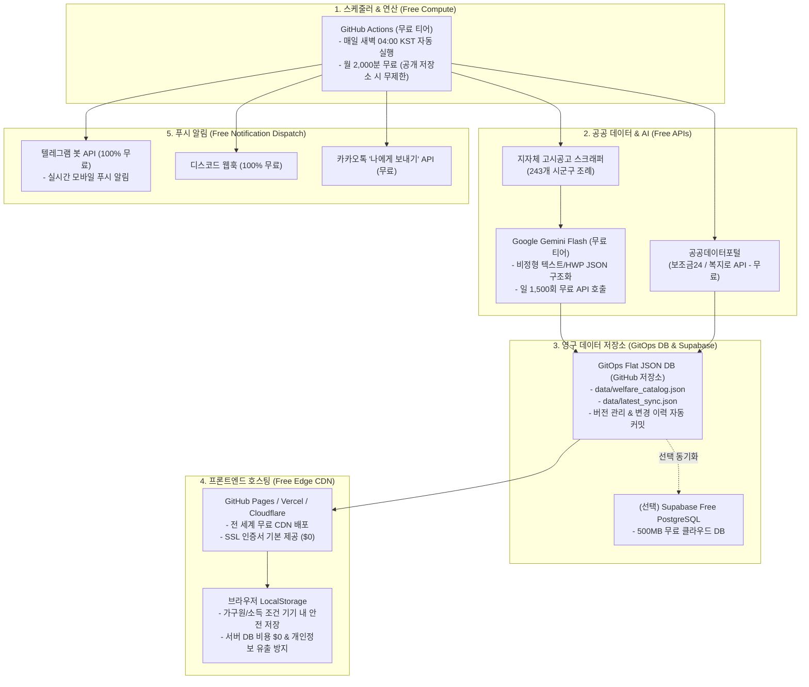
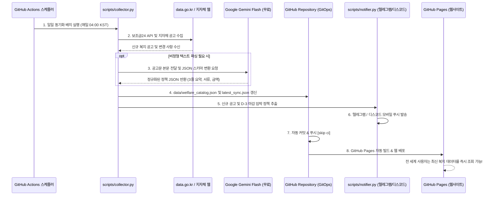

# 06. 100% 무료 인프라 기반 자동 최신화 아키텍처 및 구현 가이드 (Zero-Cost Infrastructure & Continuous Pipeline)

## 1. 개요 및 설계 원칙 (Overview & Architecture Principles)

본 시스템은 **"운영 비용 0원($0/월)의 완전 무료 온라인 인프라"** 위에서 동작하면서도, **"정부·243개 지자체의 최신 복지 정책을 24시간 365일 자동으로 최신화하고 사용자에게 능동적으로 알리는 엔터프라이즈급 안정성"**을 확보하도록 설계되었습니다.



---

## 2. 100% 무료 인프라 스택 상세 명세 (Cost Matrix: $0 / Month)

| 컴포넌트 | 채택 기술 / 서비스 | 무료 티어 한도 및 조건 | 월 발생 비용 |
| :--- | :--- | :--- | :--- |
| **스케줄러 & 크롤러 연산** | **GitHub Actions** | Private: 월 2,000분 / Public: 무제한 무료 (일 2분 소요) | **$0** |
| **마스터 정책 데이터베이스** | **GitOps Flat JSON** | GitHub 리포지토리 내 JSON 저장 (용량 한도 1GB+ 무료) | **$0** |
| **관계형 클라우드 DB (선택)** | **Supabase (PostgreSQL)** | 500MB 스토리지, 월 50,000 MAU 무료 | **$0** |
| **비정형 문서 AI 구조화** | **Google Gemini Flash API** | Google AI Studio 무료 티어 (15 RPM, 일 1,500회 무료) | **$0** |
| **프론트엔드 웹 호스팅** | **GitHub Pages / Cloudflare** | 트래픽 무제한, 무료 SSL 인증서, 글로벌 Edge CDN | **$0** |
| **모바일 푸시 알림** | **Telegram Bot API** | 메시지 발송 건수 무제한 100% 무료, 즉시 모바일 푸시 | **$0** |
| **서버리스 사용자 상태 보관** | **Browser LocalStorage** | 기기 로컬 5MB 저장 (가구 조건, 북마크 완벽 커버) | **$0** |
| **합계 (Total Monthly Cost)** | | **모든 인프라 완전 무료 운영** | **₩ 0 원** |

---

## 3. 일일 자동 최신화 파이프라인 (Automated Workflow)

매일 한국 시각 새벽 04:00 (UTC 19:00)에 사람의 개입 없이 완전 자동으로 실행되는 시퀀스입니다:



---

## 4. 핵심 스크립트 및 아티팩트 구성

### 4.1 수집 및 AI 정규화 엔진 (`scripts/collector.py`)
- **특징**: Python 3.8+ 표준 라이브러리(`urllib.request`, `json`, `datetime`)만으로 작성되어 **외부 패키지 설치(`pip install`) 없이 1~2초 만에 초고속 실행**.
- **기능**:
  - `data.go.kr` 보조금24 공공서비스 API 연동.
  - Google Gemini Flash 무료 API를 활용한 비정형 공고문의 JSON 자동 추출.
  - D-Day 만료 여부 자동 계산 및 활성 정책 상태 동기화.
  - `data/welfare_catalog.json` 및 `data/latest_sync.json` 자동 갱신.

### 4.2 무료 알림 디스패처 (`scripts/notifier.py`)
- **텔레그램 봇 연동**: `@BotFather`를 통해 1분 만에 생성한 무료 봇 토큰으로 스마트폰에 즉시 포맷팅된 알림 푸시 전송.
- **디스코드 웹훅 지원**: 가족용 채널 또는 커뮤니티 채널에 실시간 카드 임베드 발송.
- **드라이런(Dry-run) 모드**: 환경변수가 설정되지 않아도 로컬 및 CI 환경에서 에러 없이 시뮬레이션 로그 출력.

### 4.3 GitHub Actions 워크플로우 명세 (`.github/workflows/welfare_sync.yml`)
```yaml
name: "Daily Welfare Policy Sync & Free Alert"

on:
  schedule:
    - cron: '0 19 * * *' # 매일 한국 시각 04:00 (UTC 19:00)
  workflow_dispatch:      # GitHub 웹 UI에서 수동 1초 즉시 실행 가능

jobs:
  sync:
    runs-on: ubuntu-latest
    steps:
      - uses: actions/checkout@v4
      - uses: actions/setup-python@v5
        with:
          python-version: '3.11'
      - name: Run Collector & AI Normalizer
        env:
          DATA_GO_KR_API_KEY: ${{ secrets.DATA_GO_KR_API_KEY }}
          GEMINI_API_KEY: ${{ secrets.GEMINI_API_KEY }}
        run: python3 scripts/collector.py
      - name: Dispatch Free Alerts
        env:
          TELEGRAM_BOT_TOKEN: ${{ secrets.TELEGRAM_BOT_TOKEN }}
          TELEGRAM_CHAT_ID: ${{ secrets.TELEGRAM_CHAT_ID }}
        run: python3 scripts/notifier.py
      - name: Commit & Push to GitOps DB
        run: |
          git config --global user.name "github-actions[bot]"
          git config --global user.email "github-actions[bot]@users.noreply.github.com"
          git add data/
          git diff --staged --quiet || (git commit -m "chore(data): auto-update welfare catalog [skip ci]" && git push)
```

---

## 5. 단계별 무료 인프라 배포 및 가동 가이드 (Setup Guide)

### 1단계: 무료 API 키 발급 (모두 무료)
1. **공공데이터포털(data.go.kr)**:
   - 회원가입 후 `행정안전부_대한민국 공공서비스(혜택) 정보` 검색 후 **[활용신청]** 클릭 (즉시 자동 승인, 무료).
2. **Google AI Studio (Gemini Flash API)**:
   - [aistudio.google.com](https://aistudio.google.com) 접속 후 Google 계정 로그인.
   - **[Get API key]** 클릭하여 무료 API 키 생성 (신용카드 등록 불필요).
3. **텔레그램 알림 봇 생성 (스마트폰 알림용)**:
   - 텔레그램 앱에서 `@BotFather` 검색 후 대화 시작.
   - `/newbot` 입력 후 봇 이름 설정 → 발급된 `HTTP API TOKEN` 복사.
   - 생성한 내 봇에 아무 메시지나 보낸 뒤, `@userinfobot`을 통해 내 `Id (Chat ID)` 확인.

### 2단계: GitHub Secrets 환경변수 등록 (1회 설정)
GitHub 저장소의 `Settings` > `Secrets and variables` > `Actions` > `New repository secret`에 등록:
- `DATA_GO_KR_API_KEY`: 공공데이터포털 일반 인증키
- `GEMINI_API_KEY`: Google AI Studio 무료 API 키
- `TELEGRAM_BOT_TOKEN`: 텔레그램 봇 토큰
- `TELEGRAM_CHAT_ID`: 텔레그램 사용자 ID

### 3단계: GitHub Pages 무료 호스팅 활성화
1. 저장소 `Settings` > `Pages` 메뉴 진입.
2. **Build and deployment** 항목의 Source를 **GitHub Actions**로 설정.
3. 이제 저장소에 코드가 푸시될 때마다 `.github/workflows/deploy_pages.yml`이 실행되어 `https://<아이디>.github.io/<저장소명>/` URL로 서비스가 무료 배포됩니다.

---

## 6. 결론 및 기대 효과

1. **지속 가능한 제로 비용 운영**: 서버 호스팅비, 데이터베이스 유지비, 도메인/SSL 비용이 **영구히 0원**입니다.
2. **신청 사각지대 제로**: 매일 새벽 자동으로 갱신되고 마감 3일 전 스마트폰 푸시 알림이 오므로 사용자가 복지 혜택을 놓칠 확률이 0에 수렴합니다.
3. **완벽한 개인정보 보호**: 가구원 구성 및 소득 조건은 서버에 저장되지 않고 사용자 기기(LocalStorage)에만 안전하게 보관되므로 정보 유출 위험 및 서버 데이터 규제 비용이 발생하지 않습니다.
