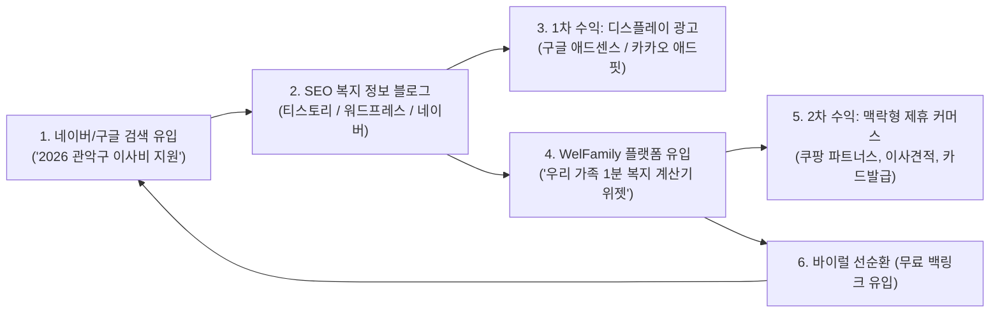

# 07. 광고 및 광고 블로그 연계 수익화 전략 보고서 (Advertising & Blog Affiliate Strategy)

## 1. 개요 및 기획 배경 (Executive Summary)

### 1.1 왜 복지 정보와 광고/블로그의 결합인가?
- **압도적인 검색 트래픽**: 대한민국 포털(네이버, 구글, 다음)에서 ‘부모급여 신청방법’, ‘청년월세지원 조건’, ‘지자체 출산장려금’, ‘기초연금 수급자격’ 등의 키워드는 매월 수백만 건의 검색량을 기록하는 **초대형 상시 검색 수요(Evergreen Search Intent)**입니다.
- **높은 광고 단가 (High AdSense/AdFit CPC)**: 정부 지원금, 부동산(전월세/이사), 금융(청년도약계좌/적금), 육아/출산 관련 키워드는 일반 엔터테인먼트 대비 구글 애드센스 및 카카오 애드핏의 **클릭당 단가(CPC)가 3~5배 이상 높게 형성**되어 있습니다.
- **맥락적 구매 전환율 (High Affiliate Conversion)**: 복지 혜택을 검색하는 사용자는 특정 **인생 이벤트(출산, 이사, 독립, 취업, 은퇴)**를 겪고 있는 단계이므로, 해당 상황에 꼭 필요한 상품/서비스(기저귀/분유, 이사 견적, 인터넷 개통, 건강기능식품 등)를 연계할 때 제휴 마케팅 전환율이 매우 높습니다.



---

## 2. 4대 광고 및 블로그 연계 비즈니스 모델

### 2.1 전략 1: 자동화 SEO 복지 블로그 발행 엔진 (Welfare Content Engine)
- **동작 방식**: [scripts/collector.py](file:///Users/jeonghyun/Documents/GitHub/wellness-for-family/scripts/collector.py)를 통해 수집된 최신 정책 데이터를 기반으로, [scripts/blog_generator.py](file:///Users/jeonghyun/Documents/GitHub/wellness-for-family/scripts/blog_generator.py)가 검색엔진 최적화(SEO)된 고품질 포스팅을 전자동 생성.
- **블로그 포스팅 구조**:
  1. **클릭을 부르는 제목**: `[2026년 최신] 00시 00구 지원금 40만원! 대상 조건 및 필수 구비서류 3줄 요약`
  2. **핵심 요약 박스**: 바쁜 사용자를 위한 요약 (네이버 스마트블록 및 구글 Featured Snippet 노출 타깃)
  3. **본문 중간 애드센스 배너 슬롯**: 문맥 중간 자연스러운 광고 배치 (`In-Article Ads`)
  4. **구비서류 및 신청 방법**: 정부24 발급 링크 및 주민센터 위치
  5. **WelFamily 위젯 CTA**: "우리 집 조건으로 받을 수 있는 다른 혜택도 지금 확인해보세요" (플랫폼 유입 링크)

---

### 2.2 전략 2: 생애주기 맞춤형 제휴 마케팅 (Contextual Affiliate Model)
무분별한 광고가 아닌, 사용자가 신청하려는 복지 정책의 성격에 100% 부합하는 제휴 링크를 노출하여 사용자 편의성과 수익을 동시에 달성합니다.

| 복지 카테고리 | 연계 제휴 상품 / 서비스 | 제휴 네트워크 (Partners) | 예상 건당 수수료 (CPA/CPS) |
| :--- | :--- | :--- | :--- |
| **청년·신혼부부 이사비/주거** | 포장이사 무료 견적 비교, 원룸 이사 | 짐싸, 미소, 숨고 제휴 | 건당 ₩15,000 ~ ₩30,000 |
| **이사 및 전입 공통** | 인터넷/IPTV 신규 가입 현금 지원 | 통신 3사 대리점 / 아정당 제휴 | 개통 건당 ₩40,000 ~ ₩80,000 |
| **출산·영유아 (부모급여 등)** | 기저귀, 분유, 유모차, 카시트 | 쿠팡 파트너스, 네이버 쇼핑 커머스 | 구매액의 3.0% ~ 5.0% |
| **임산부 및 신생아** | 국민행복카드 / 아이행복카드 신규 발급 | 카드사(신한/삼성/국민) 신규 발급 제휴 | 카드 발급 및 사용 시 ₩100,000~₩150,000 |
| **청년 자산형성 (도약계좌)** | 고금리 파킹통장, CMA, 적금 상품 비교 | 뱅크샐러드, 핀다, 금융사 오픈 API | 신규 개설 건당 ₩10,000 ~ ₩30,000 |
| **어르신 기초연금/돌봄** | 시니어 안마의자 렌탈, 관절 건강기능식품 | 렌탈사 제휴, 건기식 브랜드 | 렌탈 계약 시 ₩50,000 ~ ₩150,000 |

---

### 2.3 전략 3: 인앱 네이티브 디스플레이 광고 (In-App AdSense & AdFit)
플랫폼 UI 디자인을 해치지 않는 세련된 인앱 광고 배치를 구현합니다:
1. **인피드 네이티브 카드 광고 (In-Feed Native Ads)**:
   - 복지 정책 리스트 3~4개마다 1개씩 정책 카드와 동일한 카드 UI로 렌더링되는 스폰서 배너.
2. **상세 모달 스폰서드 솔루션 (Contextual Callout Banner)**:
   - 예: '관악구 이사비 지원' 상세 모달 하단에 `[스폰서] 이사 전 필수! 1분 무료 방문견적 비교하기` 버튼 삽입.
3. **하단 고정형 리워드/다이제스트 배너**:
   - 모바일 하단에 가볍게 노출되는 반응형 배너.

---

### 2.4 전략 4: 외부 블로거용 무료 임베드 위젯 배포 (Viral Widget Flywheel)
재테크/복지 전문 블로거들이 자신의 포스팅에 복사하여 붙여넣을 수 있는 **'우리 가족 맞춤 복지 계산기 위젯 (widget.html)'**을 무료로 배포합니다.

- **위젯 코드 예시**:
  ```html
  <iframe src="https://<사용자아이디>.github.io/wellness-for-family/prototype/widget.html" 
          width="100%" height="340" frameborder="0" style="border-radius: 16px; box-shadow: 0 4px 20px rgba(0,0,0,0.08);"></iframe>
  ```
- **블로거 혜택**: 방문자가 위젯으로 지역과 조건을 클릭해보며 페이지 체류 시간(Dwell Time)이 대폭 증가하여 블로그의 검색 순위와 애드센스 수익이 극대화됨.
- **WelFamily 혜택**: 수많은 블로그로부터 양질의 외부 백링크(Backlink)와 신규 방문자 유입이 24시간 발생 (광고비 $0 유입).

---

## 3. 공정위 규정 및 공공성 준수 윤리 가이드라인

공공 복지 정보의 신뢰성을 지키면서 합법적이고 건전한 수익을 창출하기 위해 다음 원칙을 반드시 준수합니다:

1. **경제적 대가성 표기 의무화**:
   - 제휴 링크 및 쿠팡 파트너스 링크 하단에 표준 안내 문구 필수 명기:
     > *"이 포스팅/영역은 제휴마케팅 활동의 일환으로, 이에 따른 일정액의 수수료를 제공받을 수 있습니다."*
2. **공식 신청 채널과의 엄격한 분리**:
   - 정부24, 복지로 등 국가 공식 신청 링크는 상단에 명확하게 배치하고, 스폰서 상품은 `[제휴 안내]` 배지로 명확히 구분.
3. **정부 사칭 금지**:
   - "정부 공식 대행사", "정부 지정" 등의 허위·과장 문구를 절대 사용하지 않으며, "민간 맞춤형 복지 정보 큐레이션 서비스"임을 명시.
