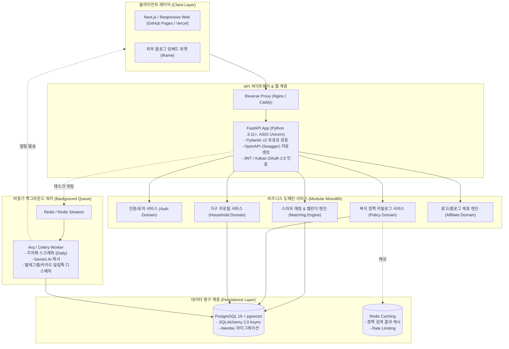
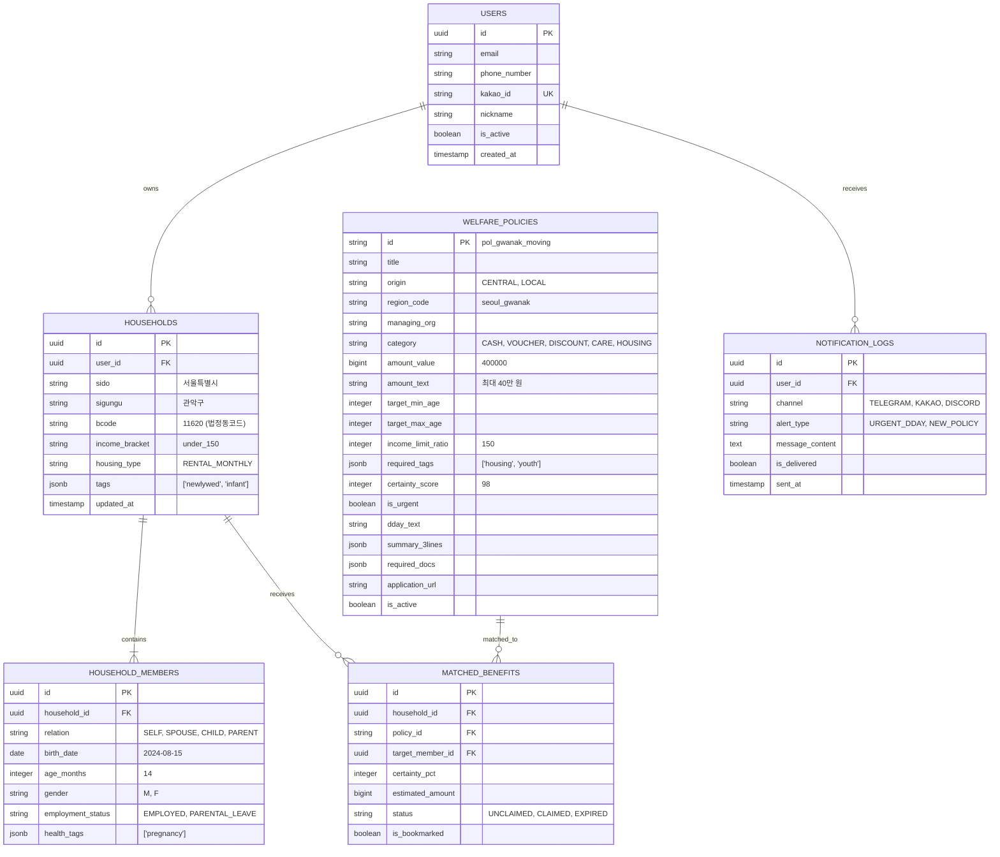

# 08. 백엔드 시스템 구현 계획 및 기술 아키텍처 명세서 (Backend Implementation Plan)

## 1. 개요 및 시스템 목표 (Overview & Objectives)

본 문서는 **웰패밀리(WelFamily)** 서비스의 프로토타입 및 데이터 파이프라인을 상용 수준의 확장 가능하고 견고한 백엔드 시스템으로 전환하기 위한 **엔드투엔드 백엔드 구현 계획서(Technical Implementation Plan)**입니다.

### 1.1 백엔드 핵심 목표
1. **고성능 맞춤형 정책 매칭 API**: 가구원 구성(연령, 관계, 건강), 소득 구간, 행정구역(243개 지자체 행정동 코드) 조건에 대해 50ms 이내에 초개인화 수혜 리스트 및 연간 현금 지원 총액을 산출.
2. **이벤트 기반 비동기 파이프라인**: 243개 지자체 고시공고 수집, HWP/PDF 비정형 문서의 Gemini Flash LLM 구조화, 카카오 알림톡/텔레그램 알림 디스패치를 워커 큐(Celery/Arq)로 분리 처리.
3. **100% 무료 인프라 호환성 유지**: 로컬 개발(Docker Compose)부터 상용 무료 티어(Oracle Cloud Free Tier, Supabase PostgreSQL, Vercel/Render)까지 $0 비용으로 유연하게 배포 가능한 모듈러 모놀리스(Modular Monolith) 구조 채택.

---

## 2. 기술 스택 선정 및 아키텍처 (Tech Stack Selection)



### 2.1 주요 기술 선정 사유
| 계층 (Layer) | 채택 기술 | 선정 사유 및 대안 비교 |
| :--- | :--- | :--- |
| **언어 & 프레임워크** | **Python 3.11+ / FastAPI** | - 비동기(AsyncIO) 지원으로 초당 수천 건의 API 요청 고속 처리<br>- 기존 구축된 `collector.py`, `notifier.py`, Gemini AI 파이프라인과 100% 동일한 언어 환경 공유<br>- Pydantic v2 기반 자동 데이터 검증 및 Swagger UI 자동 생성 |
| **데이터베이스** | **PostgreSQL 16 + pgvector** | - 복지 혜택의 복합 조건(JSONB)과 행정동 공간/키워드 검색 최적화<br>- 향후 복지 질문-답변 AI 시맨틱 검색을 위한 벡터 임베딩(`pgvector`) 내장 지원<br>- Supabase 무료 티어(500MB) 및 로컬 도커 완벽 호환 |
| **ORM & 마이그레이션** | **SQLAlchemy 2.0 (Async) + Alembic** | - 비동기 세션(`AsyncSession`) 지원으로 I/O 병목 제거<br>- 강력한 스키마 버전 관리 및 마이그레이션 자동화 |
| **캐시 & 작업 큐** | **Redis + Arq (or Celery)** | - 정책 검색 결과 및 행정동 코드 인메모리 초고속 캐싱<br>- 가볍고 비동기 친화적인 Arq 워커로 알림톡 및 스크래핑 비동기 디스패치 |

---

## 3. 백엔드 디렉토리 구조 (Backend Project Layout)

도메인 주도 설계(Domain-Driven Design)를 단순화한 **계층형 모듈러 아키텍처**로 구성합니다.

```
backend/
├── app/
│   ├── main.py                     # FastAPI 진입점 및 미들웨어 설정
│   ├── core/                       # 전역 설정 및 보안
│   │   ├── config.py               # pydantic-settings 환경변수 관리
│   │   ├── database.py             # SQLAlchemy Async Engine & SessionLocal
│   │   ├── security.py             # JWT 생성/검증, 비밀번호 해싱
│   │   └── redis.py                # Redis 클라이언트 및 캐시 유틸
│   │
│   ├── api/                        # API 라우트 컨트롤러
│   │   ├── v1/
│   │   │   ├── api.py              # v1 통합 라우터
│   │   │   ├── auth.py             # 카카오 소셜 로그인, JWT 토큰 발급
│   │   │   ├── households.py       # 가구 조건, 구성원, 소득 설정 CRUD
│   │   │   ├── policies.py         # 복지 정책 목록, 상세, 지자체 필터
│   │   │   ├── matching.py         # 맞춤 혜택 계산기, 캘린더 타임라인
│   │   │   ├── notifications.py    # 알림 설정 및 발송 이력
│   │   │   └── widgets.py          # 블로그 임베드 위젯 연동 API
│   │
│   ├── models/                     # SQLAlchemy ORM 모델
│   │   ├── user.py                 # User, SocialAccount
│   │   ├── household.py            # Household, HouseholdMember
│   │   ├── policy.py               # WelfarePolicy, PolicyEligibilityRule
│   │   ├── match.py                # MatchedBenefit, UserBookmark
│   │   └── notification.py         # NotificationHistory
│   │
│   ├── schemas/                    # Pydantic v2 Request/Response 스키마
│   │   ├── user.py
│   │   ├── household.py
│   │   ├── policy.py
│   │   ├── matching.py
│   │   └── widget.py
│   │
│   ├── services/                   # 비즈니스 로직 계층
│   │   ├── auth_service.py         # 카카오 OAuth 통신 및 회원 처리
│   │   ├── matching_engine.py      # ★ 핵심: 3단계 수혜 매칭 및 금액 환산
│   │   ├── policy_service.py       # 정책 조회, 지자체 코드 매핑, 검색
│   │   └── notification_service.py # 텔레그램/알림톡/디스코드 발송 라우팅
│   │
│   └── workers/                    # 비동기 백그라운드 태스크
│       ├── tasks.py                # 스크래핑, 마감 D-Day 알림 배치
│       └── scheduler.py            # Cron 스케줄러 (매일 04:00 KST)
│
├── alembic/                        # DB 마이그레이션 스크립트
├── tests/                          # Pytest 테스트 스위트
│   ├── conftest.py
│   ├── test_matching_engine.py     # 매칭 알고리즘 정밀 테스트
│   ├── test_policies.py
│   └── test_households.py
├── Dockerfile                      # 경량 프로덕션 컨테이너 이미지
├── docker-compose.yml              # Local Dev: FastAPI + PostgreSQL + Redis
├── pyproject.toml / requirements.txt
└── .env.example
```

---

## 4. 데이터베이스 엔티티 설계 (Core Data Models)



---

## 5. 핵심 비즈니스 로직: 매칭 알고리즘 명세 (Matching Engine Spec)

매칭 엔진(`app/services/matching_engine.py`)은 3단계 파이프라인으로 구현됩니다:

```python
# app/services/matching_engine.py 의 핵심 로직 설계
class MatchingEngine:
    @staticmethod
    def match_policy_against_household(policy: WelfarePolicy, household: Household) -> MatchResult:
        # 1단계: 행정구역(지역) 하드 필터
        if policy.region_code != "ALL" and policy.region_code != f"{household.sido}_{household.sigungu}":
            return MatchResult(is_matched=False, reason="REGION_MISMATCH")

        # 2단계: 가구 소득 상한선 필터
        user_income_ratio = parse_income_ratio(household.income_bracket) # e.g. 150
        if user_income_ratio > policy.income_limit_ratio:
            return MatchResult(is_matched=False, reason="INCOME_EXCEEDED")

        # 3단계: 가구원 대상 연령 및 속성 매칭
        eligible_members = []
        for member in household.members:
            age_years = calculate_age_years(member.birth_date)
            if policy.target_min_age <= age_years <= policy.target_max_age:
                eligible_members.append(member)

        if not eligible_members and policy.target_max_age < 100:
            return MatchResult(is_matched=False, reason="NO_ELIGIBLE_MEMBER_AGE")

        # 4단계: 특성 태그 교집합 검사
        household_tags = set(household.tags or [])
        required_tags = set(policy.required_tags or [])
        if required_tags and not required_tags.intersection(household_tags):
            return MatchResult(is_matched=False, reason="TAG_CONDITION_UNMET")

        # 5단계: 매칭 성공 및 예상 수혜액 계산
        estimated_benefit = calculate_annual_amount(policy, eligible_members)
        certainty = policy.certainty_score

        return MatchResult(
            is_matched=True,
            certainty_score=certainty,
            estimated_annual_amount=estimated_benefit,
            target_member_ids=[m.id for m in eligible_members]
        )
```

---

## 6. 핵심 REST API 엔드포인트 명세 (API Contract)

### 6.1 인증 및 가구 프로필 (Auth & Household)
- `POST /api/v1/auth/kakao/login` : 카카오 인가 코드로 로그인 및 JWT 토큰(Access/Refresh) 발급
- `GET /api/v1/households/me` : 현재 로그인 사용자의 가구 프로필 및 가구원 목록 조회
- `PUT /api/v1/households/me` : 거주지(시군구), 소득구간, 특성 태그 업데이트 (동기화)
- `POST /api/v1/households/members` : 가구원(배우자, 자녀, 부모) 추가
- `DELETE /api/v1/households/members/{member_id}` : 가구원 삭제

### 6.2 복지 정책 카탈로그 (Policies)
- `GET /api/v1/policies` : 정책 목록 조회 (페이징, 검색어, 카테고리, 지자체/중앙 필터)
- `GET /api/v1/policies/{policy_id}` : 정책 상세 조회 (3줄 요약, 구비서류 목록, 제휴사 추천)
- `GET /api/v1/policies/regions` : 전국 243개 지자체 코드 및 목록 조회

### 6.3 맞춤 매칭 및 캘린더 (Matching & Calendar)
- `GET /api/v1/matching/dashboard` : 우리 가구 총 예상 수혜액, 수령 중 혜택, 미신청 혜택, 매칭 정책 리스트 일괄 반환
- `GET /api/v1/matching/calendar?year=2026&month=11` : 월별 지원금 정기 입금일(25일 등) 및 신청 마감 D-Day 타임라인 이벤트 반환
- `POST /api/v1/matching/policies/{policy_id}/status` : 혜택 신청 완료(CLAIMED) 또는 보관(BOOKMARK) 토글

### 6.4 외부 위젯 및 블로그 제휴 (Widget & Affiliate)
- `GET /api/v1/widget/calculate?region=seoul_gwanak&family=infant` : 블로그 임베드 위젯용 간이 혜택 시뮬레이션 데이터 반환
- `POST /api/v1/affiliate/click` : 제휴사(이사 견적, 쿠팡 등) 아웃바운드 링크 클릭 로깅 (통계 수집)

---

## 7. 단계별 구현 마일스톤 및 일정 (Execution Sprints)

| 스프린트 | 구현 항목 및 산출물 | 소요 기간 |
| :--- | :--- | :--- |
| **Sprint 1: 기반 인프라 & 도메인 모델** | - FastAPI 프로젝트 구조화, Docker Compose 환경 구성<br>- PostgreSQL 스키마 및 Alembic 마이그레이션 적용<br>- Pydantic 스키마 정의 및 JWT / 카카오 OAuth 인증 구현 | 1~2일 |
| **Sprint 2: 정책 카탈로그 & 매칭 엔진** | - `data/welfare_catalog.json` 시드 데이터 로더 구현<br>- 3단계 스마트 매칭 엔진(`matching_engine.py`) 및 단위 테스트<br>- 대시보드 및 복지 캘린더 API 완성 | 2~3일 |
| **Sprint 3: 비동기 파이프라인 & 알림 워커** | - Redis + Arq 비동기 태스크 큐 구축<br>- 지자체 수집기(`collector.py`) 및 Gemini Flash 파서 연동<br>- 텔레그램 / 디스코드 / 카카오 알림톡 디스패처 통합 | 2일 |
| **Sprint 4: 위젯 API & 테스트/프로덕션 배포** | - 블로그 임베드 위젯 API 및 클릭 로깅<br>- Pytest 엔드투엔드 테스트 (커버리지 85%+)<br>- GitHub Actions CI/CD 및 무료 클라우드 배포 스크립트 작성 | 1~2일 |
