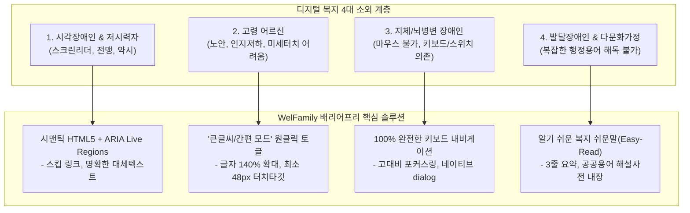

# 09. 배리어프리(Barrier-Free) 포용적 프론트엔드 디자인 및 웹표준 명세서 (Inclusive Web Design & Accessibility Spec)

## 1. 디자인 철학: "복지 정보에서 소외되는 국민은 단 한 명도 없어야 한다"

대한민국 복지 서비스의 가장 큰 모순은 **"복지 혜택이 가장 절실한 사람(고령층, 장애인, 다문화 가정, 디지털 취약계층)일수록 디지털 화면의 작은 글씨, 복잡한 인증, 난해한 행정 용어 때문에 가장 먼저 소외된다"**는 점입니다.

**WelFamily 포용적 프론트엔드 디자인**은 국내 **한국형 웹 콘텐츠 접근성 지침 (KWCAG 2.2)** 및 글로벌 **W3C WCAG 2.2 (Level AA/AAA)**, 그리고 최신 **Modern Web Standards**를 충족하여 모든 계층이 편리하게 사용할 수 있는 유니버설 디자인(Universal Design)을 구현합니다.

---

## 2. 4대 취약계층 페르소나 및 배리어프리 대응 전략



---

## 3. 핵심 웹 접근성 & 모던 웹 표준 구현 규칙

### 3.1 랜드마크 및 내비게이션 구조 (Landmarks & Navigation)
- **스킵 링크 (Skip Link)**: 키보드 사용자와 스크린리더 사용자가 반복되는 헤더를 건너뛰고 본문으로 직행할 수 있도록 최상단에 `본문 바로가기` 링크 배치.
  ```html
  <a href="#main-content" class="skip-link">본문 바로가기</a>
  ```
  ```css
  .skip-link {
    position: absolute;
    top: -100px;
    left: 1rem;
    padding: 0.75rem 1.25rem;
    background: #1e40af;
    color: #ffffff;
    font-weight: bold;
    z-index: 1000;
    border-radius: 0.5rem;
    transition: top 0.2s ease-in-out;
  }
  .skip-link:focus {
    top: 1rem;
    outline: 3px solid #facc15;
  }
  ```
- **명확한 시맨틱 랜드마크**: `<header>`, `<nav aria-label="주요 메뉴">`, `<main id="main-content">`, `<aside>`, `<footer>`로 완벽 분리.

### 3.2 네이티브 `<dialog>` 모달 및 스크롤 체이닝 차단
- 기존의 비표준 `<div>` 오버레이 대신 **HTML5 표준 `<dialog>` 요소**로 전면 전환.
- 브라우저 기본 지원: `Esc` 키 닫기, 백드롭 클릭 닫기, 배경 페이지 `inert` 자동 처리, 포커스 복원.
- **스크롤 체이닝 방지 (`modern-web-guidance` 표준 준수)**:
  ```css
  dialog:modal {
    overscroll-behavior: contain;
  }
  dialog::backdrop {
    overflow: hidden;
    overscroll-behavior: contain;
    background: rgba(15, 23, 42, 0.65);
    backdrop-filter: blur(4px);
  }
  ```

### 3.3 색상 대비 및 Forced Colors Mode (High Contrast)
- **명도 대비 기준**: 일반 본문 텍스트는 최소 **4.5:1 이상**, 대형 텍스트 및 UI 테두리는 **3.0:1 이상** 준수.
- **색상에만 의존한 정보 전달 금지**: 성공(초록), 경고(주황), 오류(빨강) 표시 시 반드시 아이콘(`aria-hidden="true"`)과 명확한 텍스트 문구를 병기.
- **윈도우 고대비 모드(Forced Colors Mode) 지원**:
  ```css
  @media (forced-colors: active) {
    .btn-primary, .badge-local, .badge-central {
      border: 2px solid ButtonText !important;
      color: ButtonText !important;
      background: ButtonFace !important;
    }
  }
  ```

### 3.4 키보드 포커스 및 터치 타깃 (Focus & Target Size)
- **초점 표시자(Focus Indicator)**: 브라우저 기본 outline을 지우지 않고(`outline: none` 절대 금지), 모든 상호작용 요소에 선명한 고대비 포커스 링 적용:
  ```css
  *:focus-visible {
    outline: 3px solid #2563eb !important;
    outline-offset: 2px !important;
  }
  ```
- **최소 터치 타깃 크기 (Target Size)**:
  - 모바일 및 고령층 손떨림 환경을 고려하여 모든 버튼과 입력창의 최소 터치 영역을 **44px × 44px 이상** (큰글씨 모드 시 **48px × 48px 이상**)으로 확보.

### 3.5 스크린리더 동적 알림 (ARIA Live Regions)
- 사용자가 가구 프로필을 변경하거나 필터를 조작할 때, 시각적으로만 숫자가 변하면 전맹 시각장애인은 변경 사실을 알 수 없습니다.
- `aria-live="polite"` 라이브 리전을 적용하여 화면 낭독기가 실시간으로 갱신 결과를 음성 낭독:
  ```html
  <div id="a11y-announcer" class="sr-only" aria-live="polite" aria-atomic="true"></div>
  ```

### 3.6 노약자 맞춤 "큰글씨 & 간편 모드 (Senior Mode)"
- 상단 헤더에 **`[큰글씨 모드]`** 스위치 제공:
  - 폰트 기본 크기 120%~140% 자동 스케일업.
  - 행간(Line-height) 1.8 이상 확장으로 가독성 개선.
  - 복잡한 차트와 카드형 UI를 단순한 세로형 큰글씨 리스트로 전환.
  - 전문 행정용어 대신 **"지원 대상 / 받는 돈 / 신청 서류"** 3단어만 강조.

---

## 4. 검증 체크리스트 (WCAG 2.2 / KWCAG 2.2)

| 항목 | 표준 기준 | WelFamily 구현 사양 | 통과 기준 |
| :--- | :--- | :--- | :--- |
| **스킵 내비게이션** | KWCAG 1.3.1 | 본문 바로가기 스킵 링크 제공 | Tab 첫 입력 시 최상단 노출 |
| **명도 대비** | WCAG 1.4.3 | 본문 4.5:1 이상, 그래픽/테두리 3:1 이상 | WebAIM Contrast 100% Pass |
| **초점 이동** | WCAG 2.4.7 | 모든 버튼/링크에 `3px outline` 포커스 링 | 마우스 없이 Tab/Shift+Tab 순회 |
| **모달 접근성** | WCAG 2.4.3 | 네이티브 `<dialog>` 사용, `Esc` 닫기 | 닫힐 때 호출 버튼으로 포커스 복원 |
| **동적 변경 알림** | WCAG 4.1.3 | `aria-live="polite"` 라이브 리전 | 조건 변경 시 낭독기 안내 음성 출력 |
| **터치 타깃** | WCAG 2.5.8 | 모바일 최소 44px × 44px | 모바일 버튼 누락 터치 방지 |
| **텍스트 확대** | WCAG 1.4.4 | 200% 확대 시 콘텐츠 깨짐 및 기능 손실 없음 | 줌 200% 반응형 레이아웃 유지 |
| **쉬운말 표현** | 인지 접근성 | 3줄 요약 및 공공용어 순화 | 초등학교 고학년 수준 어휘 사용 |
