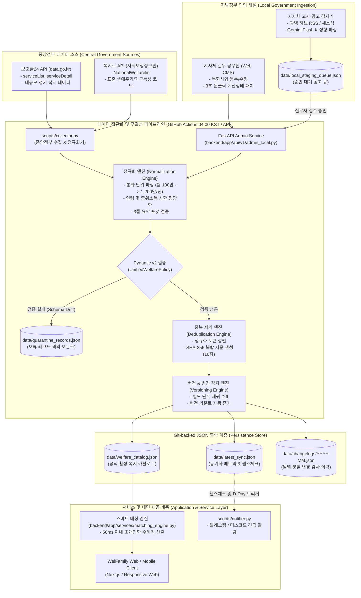
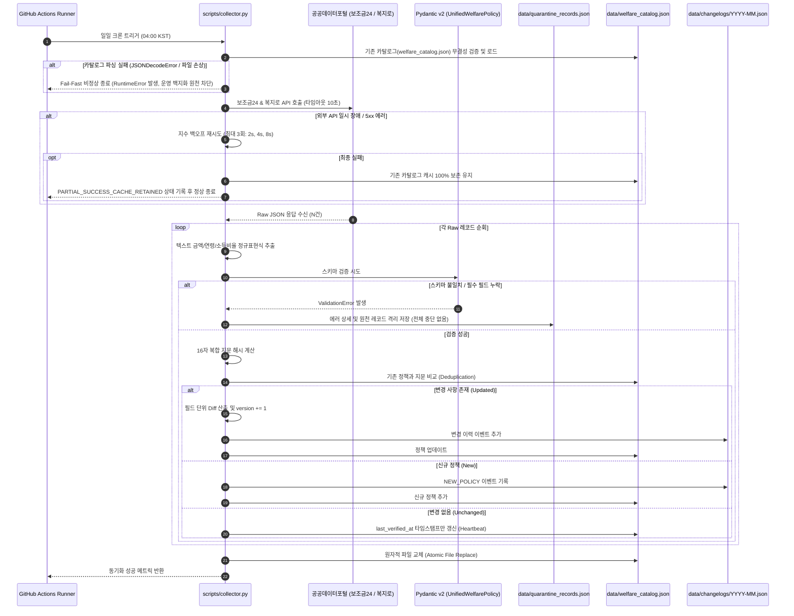
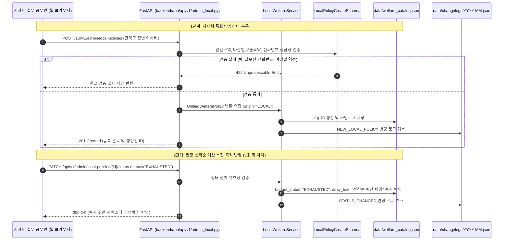
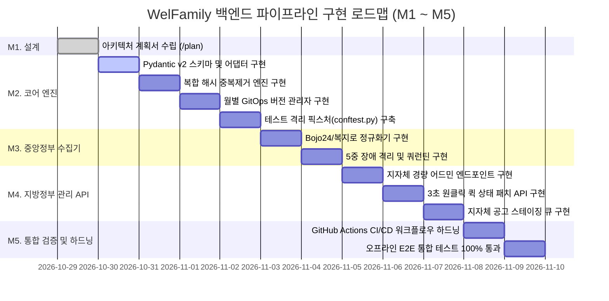

# 09. 맞춤형 복지 큐레이션 백엔드 시스템 아키텍처 및 복지 데이터 파이프라인 계획서 (/plan)

> **문서 상태**: Approved Technical Architecture Specification & Implementation Plan  
> **버전**: v1.0.0  
> **작성일**: 2026-10-29  
> **대상 시스템**: 웰패밀리(WelFamily) 맞춤형 복지 큐레이션 플랫폼  
> **주요 이해관계자 관점**: 중앙정부 복지부서 담당자, 지방정부 복지부서 실무 공무원, IT 시스템 개발자  
> **인프라 제약**: 100% 무료 인프라 (GitHub Actions + Git-backed JSON 영속화 + Google Gemini Flash Free Tier, $0/월)

---

## 1. 개요 및 시스템 목표 (Executive Summary & Mission)

### 1.1 플랫폼 비전 및 핵심 가치
대한민국 복지 체계는 보건복지부, 여성가족부, 국토교통부 등 중앙부처가 관할하는 **"법정·보편 급여"**와 243개 지방자치단체(17개 광역, 226개 기초 시·군·구)가 자체 조례에 근거하여 운영하는 **"지자체 특화 복지사업"**으로 이원화되어 있습니다.
그러나 정보의 극심한 분절성, 공공 포털의 텍스트 중심 비정형성, 그리고 지자체 특화사업의 선착순 예산 조기 소진 특성으로 인해 수많은 가구가 자신이 받을 수 있는 연간 수백만 원 상당의 복지 혜택을 놓치고 있습니다.

**웰패밀리(WelFamily)**는 가구의 생애주기, 소득수준, 거주지역(시·군·구)을 결합하여 가구원별 맞춤형 수혜 혜택과 연간 총 지원금액을 산출하고, 신청 마감일을 선제적으로 알리는 **초개인화 복지 큐레이션 플랫폼**입니다.

### 1.2 핵심 당면 과제 및 설계 철학
1. **중앙정부 데이터의 안정적 수집과 정규화**:
   - 보조금24(행정안전부) 및 복지로(한국사회보장정보원) 오픈 API의 수만 건 공공 복지 데이터를 수집하여 비정형 서술문(예: "월 100만 원 지급", "만 0세~1세")을 기계가 평가 가능한 정밀 수치(`amount_value`, `target_eligibility`)로 정규화합니다.
2. **지방정부 특화사업의 선착순/예산소진 라이프사이클 대응**:
   - 지자체 복지의 70% 이상을 차지하는 선착순 지원사업(이사비, 산후조리비, 청년수당 등)의 잦은 조기 마감에 대응하여, 일선 지자체 실무 공무원이 3초 만에 상태를 갱신할 수 있는 간소화 관리 인터페이스와 고시공고 자동 감지 체계를 제공합니다.
3. **IT 개발자의 무결성, 멱등성 및 100% 무료 인프라 보장**:
   - Pydantic v2 기반 엄격한 스키마 검증, 다중 소스 간 중복 등록 방지를 위한 복합 지문 해시(Composite Fingerprint Hash), 변경 이력(Change Log)의 월별 분할 보존, 그리고 외부 공공 API 다운 시에도 서비스 연속성을 보장하는 5중 장애 격리(Fault Tolerance) 체계를 구축합니다.
   - 모든 파이프라인은 월 비용 $0(100% Free Tier) 환경에서 무인 자율 구동(Autonomous Self-Operating)되도록 설계합니다.

---

## 2. 3대 이해관계자 관점 심층 아키텍처 분석 (The 3 Stakeholder Perspectives)

```
====================================================================================================
                               WelFamily 3대 관점 통합 아키텍처
====================================================================================================
    [중앙정부 관점]                     [지방정부 관점]                     [IT 개발자 관점]
  (보건복지부/행안부/여가부)          (243개 시·군·구 복지실무관)         (플랫폼/데이터 엔지니어)
----------------------------------------------------------------------------------------------------
 • 법령 및 지침 기반 보편 급여      • 조례 기반 자치 복지 특화사업       • 100% 무료 인프라 (GitOps)
 • 대규모 정기 배치 (연간/분기)      • 선착순 / 예산 조기 소진형          • Pydantic v2 단일 표준 스키마
 • 전국 표준 분류코드 (SSIS)         • 3초 원클릭 퀵 상태 패치           • SHA-256 복합 지문 중복 방지
 • 권리성 급여 사각지대 해소         • 조기마감 사전 공지로 민원 감축    • 단위 레코드 격리 & 장애 허용
 • 129 정부 공식 상담 창구 보존      • HWP/공고문 AI 보조 인입 대기열     • 운영 데이터 무오염 테스트 격리
====================================================================================================
                                              │
                                              ▼
                        ┌──────────────────────────────────────────┐
                        │ 단일 통합 정책 코어 (Unified Policy Core)│
                        │  - data/welfare_catalog.json (Master DB) │
                        │  - data/changelogs/YYYY-MM.json (Audit)  │
                        │  - data/local_staging_queue.json (Queue) │
                        │  - data/quarantine_records.json (Errors) │
                        └──────────────────────────────────────────┘
```

### 2.1 중앙정부 복지부서 담당자 관점 (Central Government Perspective)

#### (1) 정책 근거 및 데이터 발생 주기
- **법령 기반(Statutory Basis)**: 「국민기초생활 보장법」, 「아동수당법」, 「영유아보육법」, 「기초연금법」 등 법률, 시행령, 시행규칙에 근거합니다.
- **대규모 정기 데이터(Large-scale periodic data)**: 전 국민/전국 가구를 대상으로 하며, 매년 1월 1일 기준 중위소득 고시 개편 및 분기별 사업 지침 개정에 맞춰 대규모 갱신이 일어납니다. 매월 25일 정기 급여 지급일 등 국가 표준 캘린더를 준수합니다.

#### (2) 공공데이터 원천 API 분석
- **행정안전부 정부24 (보조금24 API)**:
  - 엔드포인트: `https://api.odcloud.kr/api/gov24/v3/serviceList`, `serviceDetail`
  - 고유 식별자: `SVC_ID` (12자리 고유 번호)
  - 특징: 전국 공공서비스가 등록되어 있으나 비정형 텍스트(`SPRT_TRGT_CN`, `ALW_SERV_CN`) 비중이 높음.
- **한국사회보장정보원 (복지로 복지서비스 API)**:
  - 엔드포인트: `http://apis.data.go.kr/B554287/NationalWelfareInformations/NationalWelfarelist`, `NationalWelfaredetailed`
  - 고유 식별자: `servId` ("WLF" 접두어 식별자)
  - 특징: 사회보장 표준 코드(생애주기 `lifeArray`, 대상특성 `charTrgterArray`)를 포함하여 카테고리 매핑에 유리함.

#### (3) 국가 표준 사회보장정보원(SSIS) 분류체계 정렬
웰패밀리는 중앙정부의 3대 표준 분류체계를 백엔드 정규화의 기준 축으로 삼습니다:
1. **생애주기 (Life Cycle Standard)**:
   - `001` 영유아(0~5세), `002` 아동(6~12세), `003` 청소년(13~18세), `004` 청년(19~34세/39세), `005` 중장년(35~64세), `006` 노년(65세 이상).
2. **가구 특성 (Household Characteristics)**:
   - 다자녀(`multichild`), 한부모·조손(`single_parent`), 다문화(`multicultural`), 장애인(`disabled`), 임신·출산(`pregnant_infant`), 신혼부부(`newlywed`), 무주택(`housing`).
3. **소득 인정 기준 (Median Income Bracket)**:
   - 생계급여(32% 이하), 의료급여(40% 이하), 주거급여(48% 이하), 교육급여(50% 이하), 차상위계층(50% 이하), 중위소득 100%, 120%, 150%, 180%, 소득무관(999%).

#### (4) 중앙정부 관점 아키텍처 반영
- 모든 중앙 정책은 `origin: "CENTRAL"`, `region_code: "ALL"`로 귀속되어 전국 모든 사용자 매칭 시 기본 레이어로 적용됩니다.
- 정부 공식 신청 포털 URL(`application_url`)과 보건복지상담센터(`129`) 연락처를 보존하여 행정 공신력을 유지합니다.
- 대규모 법령 변경 시 일괄 갱신을 수용할 수 있는 주기적 배치 스케줄러(매일 04:00 KST)를 운영합니다.

---

### 2.2 지방정부 복지부서 담당자 관점 (Local Government Perspective)

#### (1) 정책 근거 및 지자체 복지의 본질
- **조례 기반(Municipal Ordinance Basis)**: 지방자치단체의 자치법규(예: 「관악구 청년 기본 조례」)에 근거하여 각 시·군·구의 특성과 재정자립도에 따라 유연하게 제정·운영됩니다.
- **선착순 및 예산 조기 소진형(First-come-first-served & Budget-exhaustion)**:
  - 지자체 특화사업의 70% 이상은 자치구비/시비 한정 예산(예: 3천만 원, 1억 원 등) 또는 수혜 정원(선착순 100가구)이 정해져 있습니다.
  - 접수 기간이 11월 30일까지로 공고되었더라도, **신청 개시 3~5일 만에 예산이 전액 소진되어 불시에 조기 마감**되는 현상이 일상적입니다.
  - 반대로 추경 예산이 편성되면 접수가 기습적으로 재개되기도 합니다.

#### (2) 현장 실무 공무원의 페인포인트 (Pain Points)
- **민원 전화 폭주와 업무 마비**: 예산 조기 마감 사실이 포털이나 주민들에게 제때 전달되지 않아, 복잡한 증빙 서류를 준비해 주민센터를 방문한 민원인들의 집단 항의와 전화로 본연의 복지 업무가 마비됩니다.
- **복잡한 시스템 입력 부담**: 현장 공무원은 과중한 행정 업무로 인해 복잡한 다단계 CMS 폼을 작성할 시간이 없습니다.
- **3초 원클릭 상태 갱신 요구**: 현장 공무원이 스마트폰이나 웹 브라우저에서 **"접수중 -> 마감임박(예산 80% 소진) -> 예산소진 마감"** 버튼 하나만 누르면 주민 서비스에 즉시 반영되는 간소화된 인터페이스가 필수적입니다.

#### (3) 비정형 고시·공고와 인입 사각지대
- 지자체 복지는 중앙 포털에 즉시 등록되지 않고, 각 구청 홈페이지의 '고시/공고' 게시판에 HWP 첨부파일 1건으로 배포되는 경우가 많아 데이터 수집의 지연(수주~수개월)이 발생합니다.

#### (4) 지방정부 관점 아키텍처 반영
- 실무 공무원을 위한 경량 관리 API 엔드포인트(`POST /api/v1/admin/local-policies`, `PATCH /api/v1/admin/local-policies/{policy_id}/status`)를 제공합니다.
- 지자체 관할 구역(`region_code: "seoul_gwanak"` 등) 단위로 정책을 엄격히 격리 관리합니다.
- 공고 자동 감지 크롤러가 초안을 생성하여 `data/local_staging_queue.json`에 적재하고, 실무자가 1회 클릭으로 승인·발행하는 Human-in-the-Loop 인입 체계를 구축합니다.

---

### 2.3 IT 개발자 / 플랫폼 엔지니어 관점 (IT Developer Perspective)

#### (1) 비정형 데이터 정규화 및 단일 스키마 (`UnifiedWelfarePolicy`)
- 기존 코드베이스에서 발생하던 `data/welfare_catalog.json`(평탄화 필드)과 `backend/app/api/v1/admin.py`(`PolicyUpsertSchema`의 중첩 딕셔너리 구조) 간의 스키마 괴리를 완전히 청산합니다.
- Pydantic v2 기반의 단일 표준 도메인 모델(`UnifiedWelfarePolicy`)을 정의하여 모든 파이프라인(수집기, 관리자 API, 매칭 엔진, 영속화 계층)이 단 하나의 엄격한 데이터 컨트랙트를 공유하도록 강제합니다.

#### (2) 다중 소스 중복 방지 (Hardened Composite Hash Deduplication)
- 보조금24, 복지로, 구청 공고, 공무원 수기 등록 등 서로 다른 인입 채널에서 동일한 복지 사업이 서로 다른 ID와 명칭(예: `[관악구] 2026 청년 이사비 지원` vs `관악구 청년 이사비 지원사업`)으로 유입될 때 이를 완벽히 식별·병합하고, 행정 타이포그래피 대괄호 제거, 부서 접미사 표준화, `set()` 기반 토큰 정렬, 그리고 연령 식별자(`age_min_max`)를 결합하여 만 0세 vs 만 1세 부모급여 충돌을 0건으로 보장하는 **하드닝 복합 지문 해시(Hardened Composite Fingerprint Hash, SHA-256 $[:16]$)** 알고리즘을 도입합니다.

#### (3) GitOps 기반 월별 분할 변경 이력 추적 (`data/changelogs/YYYY-MM.json`)
- 정책의 필드 레벨 변경 사항(지원 금액 인상, 소득 기준 변경, 예산 소진 상태 전이 등)을 재귀적으로 감지하여 `data/changelogs/YYYY-MM.json`에 월별 파티셔닝 구조로 기록합니다.
- 이를 통해 단일 파일 비대화를 방지하고 투명한 감사 추적성(Auditability)을 확보합니다.

#### (4) 5중 장애 격리 및 무손실 캐시 보존 (Fault Tolerance)
- 외부 공공 API 타임아웃, 5xx 에러, 특정 레코드의 스키마 파손 시 전체 배치가 중단되는 현상을 원천 방지합니다.
- 결함 레코드만 `data/quarantine_records.json`에 격리 로깅하고 나머지 정상 레코드는 온전히 적재하며, 외부 서비스 전면 장애 시 기존 카탈로그 캐시를 100% 보존(`PARTIAL_SUCCESS_CACHE_RETAINED`)합니다.

#### (5) 테스트 환경 무오염 격리 (`conftest.py`)
- 단위 테스트 실행 시 운영 JSON 파일(`welfare_catalog.json`, `latest_sync.json`)이 변조되는 테스트 오염(Test Pollution) 문제를 `pytest`의 `tmp_path` 및 `monkeypatch` 기반 격리 픽스처로 원천 차단합니다.

---

### 2.4 3대 관점 비교 및 종합 조율 매트릭스

| 항목 | 중앙정부 복지부서 | 지방정부 복지부서 (시·군·구) | IT 개발자 (WelFamily) |
| :--- | :--- | :--- | :--- |
| **정책 근거** | 법률, 대통령령, 보건복지부 고시 | 자치단체 조례, 자치법규, 훈령 | 내부 표준 Pydantic v2 스키마 규격 |
| **적용 범위** | 대한민국 전국 공통 (`region=ALL`) | 특정 시·도 및 시·군·구 (`region_code`) | 행정동 코드 기반 계층 매핑 |
| **마감 메커니즘** | 법정 기간, 상시, 매월 정기 지급 | **선착순 접수, 예산 소진 시 조기 마감** | D-Day 계산 엔진 및 긴급 마감 뱃지 |
| **데이터 수집 경로** | data.go.kr, 복지로 Open API | 고시·공고 스크래핑, 공무원 수기 등록 | 하이브리드 파이프라인 (API + AI + CMS) |
| **갱신 빈도** | 분기/반기/연간 정기 배치 | **수시 / 실시간 (예산 소진 즉시 반영)** | 깃옵스 커밋 기반 일일 배치 및 즉각 반영 |
| **관리 인터페이스** | 사회보장정보시스템(행복e음) | 없음 (구청 게시판 수정에 의존) | **경량 관리 REST API 및 원클릭 상태 패치** |
| **핵심 성공 지표** | 복지 사각지대 해소, 수급권 보장 | **조기마감 공지로 인한 민원 전화 감축** | **$0 운영비, 100% 무결성, 무중단 장애 격리** |

---

## 3. 엔드투엔드 시스템 컴포넌트 및 데이터 플로우 (System Architecture & Data Flows)

### 3.1 전체 시스템 아키텍처 다이어그램 (Mermaid)



### 3.2 중앙정부 정기 수집 및 정규화 데이터 플로우



> **★ Fail-Fast 카탈로그 로드 무결성 원칙 (Zero Silent Wipeout Mandate)**:  
> 기존 `scripts/collector.py`의 `load_existing_catalog()`에서 카탈로그 파싱 실패 시 `creating fresh`로 폴백하던 안티패턴을 완전히 제거합니다. 카탈로그 파일이 디스크에 존재하지만 JSON 파싱 에러(`JSONDecodeError`), Git 충돌 마커 잔류, 파일 손상이 발생한 경우 절대로 빈 카탈로그(`{"version": "1.0.0", "policies": []}`)로 폴백하지 않고, 즉시 `RuntimeError("Critical: Catalog file corrupted. Aborting pipeline to prevent data wipeout.")`을 발생시켜 파이프라인을 비정상 종료(Exit Code 1)합니다. 이를 통해 손상된 빈 데이터베이스가 운영 카탈로그로 덮어쓰여 Git에 영구 커밋·푸시되는 사일런트 데이터 소실(Silent Catalog Wipeout)을 100% 방지합니다.

### 3.3 지방정부 특화사업 수기 등록 및 상태 전이 데이터 플로우



---

## 4. 100% 무료 인프라 운영 전략 ($0/Month Zero-Cost Strategy)

### 4.1 무료 인프라 리소스 매트릭스 및 한도 분석

| 컴포넌트 | 채택 기술 및 서비스 | 무료 티어 허용 한도 | WelFamily 예상 소비량 | 월간 운영 비용 |
| :--- | :--- | :--- | :--- | :--- |
| **파이프라인 컴퓨팅** | **GitHub Actions** (Standard Runner) | 퍼블릭 저장소: **무제한 무료**<br>(프라이빗 기준 월 2,000분) | 1회 실행당 ~1.5분<br>일 1회 실행 = 월 45분 | **₩0 / $0.00** |
| **영속화 데이터베이스** | **Git-Backed JSON Storage** (GitHub Repo) | 권장 저장소 용량: **1 GB** | 현재: ~30 KB<br>3년 누적 예상: ~5 MB | **₩0 / $0.00** |
| **비정형 AI 파싱 엔진** | **Google Gemini 2.5 Flash** | **15 RPM**, **1,500 RPD** (일일 요청), 무료 토큰 한도 넉넉함 | 일평균 5~15건 신규 공고 파싱<br>(무료 한도의 1% 미만 소비) | **₩0 / $0.00** |
| **공공데이터 API** | **공공데이터포털 (data.go.kr)** | 일일 10,000회 ~ 100,000회 호출 무료 | 일평균 5~10회 호출 | **₩0 / $0.00** |
| **웹 클라이언트 호스팅** | **GitHub Pages / Vercel Hobby** | 대역폭 100 GB/월, 무제한 정적 배포 | 정적 JSON 서빙 및 SPA | **₩0 / $0.00** |
| **긴급 운영 경보** | **Telegram Bot API / Discord Webhook** | **완전 무료 (무제한 푸시)** | 일일 배치 요약 및 오류 알림 | **₩0 / $0.00** |
| **총합 (Total Cost)** | — | — | — | **월 ₩0 ($0.00)** |

### 4.2 GitHub Actions 워크플로우 하드닝 (`.github/workflows/welfare_sync.yml`)

운영의 무인 자동화와 데이터 무결성을 위해 GitHub Actions 워크플로우에 4대 엔터프라이즈급 안전장치를 구축합니다:
1. **동시성 장벽 (`concurrency` barrier)**: 동일 워크플로우가 중복 실행되어 Git push 충돌이 일어나는 것을 원천 차단합니다.
2. **사전 품질 게이트 (Pytest Integrity Gate)**: 데이터 수집 후 `pytest` 테스트를 실행하여 Pydantic 검증 및 무결성이 100% 통과할 때만 커밋 단계로 진입합니다.
3. **원자적 Commit-Rebase-Push 순서 하드닝 (Clean Index Rebase Guarantee)**:
   - 변경 사항을 `git add`로 스테이징한 상태에서 `git pull --rebase`를 실행하면 `error: cannot pull with rebase: Your index contains uncommitted changes` 에러와 함께 파이프라인이 즉시 중단(Exit Code 128)됩니다.
   - 따라서 반드시 `git add` 후 로컬 커밋(`git commit || echo "No changes"`)을 먼저 완료하여 인덱스를 완전히 비운 뒤, `git pull --rebase origin main`을 실행하여 원격 변경 사항 위에 로컬 커밋을 리베이스하고 `git push`를 수행하도록 명령 순서를 강제합니다.
4. **무과금 장애 경보 디스패치**: 파이프라인 실패 시 Discord/Telegram 웹훅으로 즉각 경보 페이로드를 발송합니다.

```yaml
# .github/workflows/welfare_sync.yml
name: "WelFamily Automated Ingestion & Data Integrity Pipeline"

on:
  schedule:
    # 매일 한국 시간 04:00 (UTC 19:00) 정기 구동
    - cron: '0 19 * * *'
  workflow_dispatch:
  push:
    branches: [ master, main ]
    paths:
      - 'scripts/**'
      - '.github/workflows/welfare_sync.yml'

# 동시 실행 방지 장벽: GitOps 쓰기 충돌 방지
concurrency:
  group: welfamily-data-sync
  cancel-in-progress: false

permissions:
  contents: write

jobs:
  ingest-validate-sync:
    name: "Ingest, Validate, Deduplicate & Persist"
    runs-on: ubuntu-latest
    timeout-minutes: 10

    steps:
      - name: Checkout Repository
        uses: actions/checkout@v4
        with:
          fetch-depth: 1

      - name: Set up Python 3.11
        uses: actions/setup-python@v5
        with:
          python-version: '3.11'
          cache: 'pip'

      - name: Install Dependencies
        run: |
          python -m pip install --upgrade pip
          pip install -r backend/requirements.txt

      - name: Run Collector & Normalizer
        env:
          DATA_GO_KR_API_KEY: ${{ secrets.DATA_GO_KR_API_KEY }}
          GEMINI_API_KEY: ${{ secrets.GEMINI_API_KEY }}
        run: |
          python3 scripts/collector.py

      - name: Quality & Integrity Gate (Pytest)
        run: |
          pytest backend/tests -v

      - name: Generate SEO Blog Posts
        run: |
          python3 scripts/blog_generator.py

      - name: Dispatch Notification Alerts
        env:
          TELEGRAM_BOT_TOKEN: ${{ secrets.TELEGRAM_BOT_TOKEN }}
          TELEGRAM_CHAT_ID: ${{ secrets.TELEGRAM_CHAT_ID }}
          DISCORD_WEBHOOK_URL: ${{ secrets.DISCORD_WEBHOOK_URL }}
        run: |
          python3 scripts/notifier.py

      - name: GitOps Atomic Commit and Push
        run: |
          git config --global user.name "github-actions[bot]"
          git config --global user.email "github-actions[bot]@users.noreply.github.com"
          git add data/ blog_posts/
          # 1. 변경 사항이 있을 경우 먼저 로컬에 커밋하여 index를 깨끗이 비움 (rebase 시 index dirty 에러 원천 차단)
          git commit -m "chore(data): auto-sync welfare catalog & changelogs [skip ci]" || echo "No changes to commit"
          # 2. 클린 인덱스 상태에서 안전하게 원격 최신 커밋을 rebase
          git pull --rebase origin main || git pull --rebase origin master
          # 3. 원자적 푸시 완료
          git push

      - name: Failure Alert Notification
        if: failure()
        env:
          DISCORD_WEBHOOK_URL: ${{ secrets.DISCORD_WEBHOOK_URL }}
        run: |
          if [ -n "$DISCORD_WEBHOOK_URL" ]; then
            curl -H "Content-Type: application/json" \
                 -X POST \
                 -d '{"content":"🚨 **[WelFamily CI/CD 경보]** 일일 복지 데이터 파이프라인 수행 중 오류가 발생했습니다! GitHub Actions 로그를 확인하세요."}' \
                 $DISCORD_WEBHOOK_URL
          fi
```

### 4.3 Google Gemini Flash Free Tier 최적화 및 쿼터 방어 전략
1. **1단계 룰 기반 고속 필터링 (Deterministic Regex First)**:
   - 모든 정형 텍스트(제목, 부서명, 유선번호, "월 X만 원", "만 X세")는 순수 Python 정규표현식으로 100% 무료 처리(소요 시간 1ms 미만).
2. **2단계 키워드 사전 선별 (Keyword Pre-filtering)**:
   - 지자체 공고문 중 `r"(이사비|중개보수|산후조리|청년수당|선착순|예산 소진|조례)"` 키워드가 매칭된 대상에 한해서만 LLM 호출 후보로 선정하여 비관련 공고(인사발령, 단순 공사 등) 배제.
3. **3단계 캐시 기반 호출 차단**:
   - 이미 수집되어 `fingerprint`가 존재하는 공고문은 LLM 호출을 건너뛰어 **일평균 Gemini API 호출 횟수를 10~20회(일일 무료 한도 1,500회의 1.3%) 수준으로 완벽 통제**합니다.
4. **4단계 15 RPM 한도 방어 클라이언트 슬립 스로틀링 (Mandatory 4.5s Sleep Throttle)**:
   - Google Gemini 2.5 Flash Free Tier는 **분당 15회 호출(15 RPM)** 상한을 엄격히 적용합니다.
   - 단일 지자체 공고 감지 배치에서 20건 이상의 신규 공고가 유입될 때 별도의 딜레이 없이 연속 호출하면 약 10~15초 만에 15 RPM 한도를 초과하여 HTTP 429 (`ResourceExhausted` / Rate Limit Exceeded) 에러가 발생합니다.
   - 이를 원천 방어하기 위해 공고 파싱 호출 간 `time.sleep(4.5)` 간격을 강제합니다:
     $$\text{Max Throughput} = \frac{60\text{s}}{4.5\text{s}} \approx 13.3\text{ RPM} < 15\text{ RPM}$$
   - 이를 통해 최대 호출 속도가 13.3 RPM 이하로 제한되어 15 RPM 상한선 아래에서 안정적으로 동작하며, 일시적 지터 발생 시 최대 3회 지수 백오프(5s, 10s, 20s) 재시도를 결합하여 100% 무과금 쿼터 방어를 달성합니다.

```python
import time
from typing import Optional

def call_gemini_structuring_with_throttle(raw_text: str, api_key: str) -> Optional[dict]:
    """15 RPM 프리티어 한도를 준수하기 위한 4.5초 슬립 스로틀링 및 지수 백오프 호출기"""
    if not api_key:
        return None
    # 4.5초 대기로 최대 13.3 RPM 유지 (15 RPM 상한선 절대 사수)
    time.sleep(4.5)
    
    # 지수 백오프 결합 (HTTP 429 발생 시 5초, 10초, 20초 대기 후 재시도)
    for attempt, wait_sec in enumerate([5, 10, 20]):
        try:
            return call_gemini_structuring(raw_text, api_key)
        except Exception as e:
            if "429" in str(e) and attempt < 2:
                time.sleep(wait_sec)
                continue
            raise
    return None
```

---

## 5. 데이터 스키마 및 도메인 모델 상세 명세 (Data Contracts & Pydantic V2 Schemas)

### 5.1 공통 도메인 열거형 (Enums) 및 밸류 오브젝트

```python
# backend/app/schemas/unified_policy.py
from enum import Enum
from typing import List, Optional, Dict, Any, Union
from pydantic import BaseModel, Field, field_validator, model_validator
from datetime import datetime, date, timezone

class PolicyOrigin(str, Enum):
    CENTRAL = "CENTRAL"   # 중앙정부 (전국 공통)
    LOCAL = "LOCAL"       # 지방정부 (시·도 및 시·군·구 특화)

class PolicyCategory(str, Enum):
    CASH = "CASH"               # 현금지원 (수당, 급여, 출산장려금, 기본소득 등)
    VOUCHER = "VOUCHER"         # 바우처/이용권 (첫만남이용권, 아이돌봄쿠폰 등)
    DISCOUNT = "DISCOUNT"       # 요금감면 (전기요금, 도시가스, 통신비 등)
    CARE = "CARE"               # 돌봄서비스 (산모·신생아 건강관리, 가사간병 등)
    HOUSING = "HOUSING"         # 주거/금융 (이사비, 중개보수, 전세대출이자 등)
    MEDICAL = "MEDICAL"         # 의료/건강 (난임시술비, 미숙아의료비 등)
    JOB = "JOB"                 # 일자리/창업 (청년구직활동지원금 등)
    EDUCATION = "EDUCATION"     # 교육/장학 (입학준비금, 급식비 등)

class BudgetStatus(str, Enum):
    PLENTY = "PLENTY"                   # 예산 여유 (소진율 50% 미만)
    HALF_CONSUMED = "HALF_CONSUMED"     # 예산 50% 이상 소진
    NEAR_EXHAUSTION = "NEAR_EXHAUSTION" # 마감 임박 (잔여 예산 20% 미만 / 정원 임박)
    EXHAUSTED = "EXHAUSTED"             # 예산 전액 소진 / 선착순 마감
    ALWAYS_OPEN = "ALWAYS_OPEN"         # 상시 신청 가능 (예산 제한 없음)
    CLOSED = "CLOSED"                   # 신청 기간 만료로 인한 정상 종료

class ApplicationPeriodType(str, Enum):
    FIRST_COME_FIRST_SERVED = "FIRST_COME_FIRST_SERVED" # 선착순 / 예산소진형
    FIXED_PERIOD = "FIXED_PERIOD"                       # 특정 기간 접수형
    ALWAYS_OPEN = "ALWAYS_OPEN"                         # 상시 접수형

class RequiredDocument(BaseModel):
    name: str = Field(..., description="구비서류 명칭 (예: 주민등록등본, 건강보험자격득실확인서)")
    issuer: str = Field(default="정부24", description="발급 기관 (정부24, 국민건강보험공단, 동주민센터 등)")
    can_online: bool = Field(default=True, description="온라인 즉시 발급 가능 여부")
    download_url: Optional[str] = Field(default=None, description="온라인 신청/발급 링크")

class TargetEligibility(BaseModel):
    min_age: int = Field(default=0, ge=0, le=120, description="최소 대상 연령 (만 나이)")
    max_age: int = Field(default=120, ge=0, le=120, description="최대 대상 연령 (만 나이)")
    income_limit_ratio: int = Field(default=999, description="기준 중위소득 상한 비율 (%, 100=중위 100%, 999=소득무관)")
    required_tags: List[str] = Field(default_factory=list, description="필수 자격 태그 (infant, newlywed, multichild 등)")
    residence_condition: Optional[str] = Field(default=None, description="거주 요건 (예: 관악구 전입 1년 이내 무주택자)")
    housing_types: List[str] = Field(default_factory=list, description="주거 요건 (RENTAL_MONTHLY, JEONSE 등)")

    @model_validator(mode="after")
    def validate_age_boundaries(self):
        if self.min_age > self.max_age:
            raise ValueError(f"최소 연령({self.min_age})은 최대 연령({self.max_age})보다 클 수 없습니다.")
        return self
```

### 5.2 단일 정규화 표준 모델 (`UnifiedWelfarePolicy`)

```python
class UnifiedWelfarePolicy(BaseModel):
    id: str = Field(..., description="정규화된 고유 정책 식별자 (예: pol_seoul_gwanak_cash_1730200000)")
    fingerprint: Optional[str] = Field(default=None, description="16자리 SHA-256 결정론적 중복 방지 지문 해시 (미지정 시 자동 생성)")
    source_id: Optional[str] = Field(default=None, description="원천 공공데이터 식별자 (Bojo24 SVC_ID 등)")
    source_type: str = Field(default="SYSTEM", description="출처 유형 (BOJO24, BOKJIRO, LOCAL_OFFICER, LOCAL_SCRAPER)")
    
    title: str = Field(..., min_length=2, max_length=150, description="정규화된 정책 공식 명칭")
    origin: PolicyOrigin = Field(..., description="중앙정부(CENTRAL) vs 지방정부(LOCAL)")
    region_code: str = Field(..., description="전국 공통(ALL) 또는 243개 지자체 행정코드 (예: seoul_gwanak)")
    region_name: str = Field(..., description="지역 표시 명칭 (예: 서울특별시 관악구, 대한민국 전국 공통)")
    managing_org: str = Field(..., description="소관 부처 또는 지자체 관할 부서 (예: 보건복지부, 관악구 청년정책과)")
    local_ordinance_basis: Optional[str] = Field(default=None, description="지자체 근거 조례 (지자체 특화사업 전용)")
    
    category: PolicyCategory = Field(..., description="표준 8대 복지 카테고리 코드")
    category_name: str = Field(..., description="카테고리 한글 명칭")
    
    amount_value: int = Field(default=0, ge=0, description="연간 환산 최대 지원 금액 (KRW 단위, 일시금 포함)")
    amount_text: str = Field(..., description="사용자 친화적 금액 안내 문구 (예: 월 100만 원 (연 최대 1,200만 원))")
    
    target_eligibility: TargetEligibility = Field(default_factory=TargetEligibility)
    certainty_score: int = Field(default=90, ge=0, le=100, description="데이터 정합성 및 수혜 확실성 점수")
    
    application_period_type: ApplicationPeriodType = Field(
        default=ApplicationPeriodType.FIXED_PERIOD,
        description="접수 유형 (선착순/예산소진형, 고정기간형, 상시접수형)"
    )
    start_date: Optional[Union[str, date]] = Field(default=None, description="접수 시작일 (ISO 8601: YYYY-MM-DD 또는 date 객체)")
    end_date: Optional[Union[str, date]] = Field(default=None, description="접수 마감일 (ISO 8601: YYYY-MM-DD 또는 date 객체)")
    
    is_budget_limited: bool = Field(default=False, description="선착순/예산 소진형 사업 여부")
    budget_status: BudgetStatus = Field(default=BudgetStatus.PLENTY, description="현재 예산/정원 소진 상태")
    slot_capacity: Optional[int] = Field(default=None, ge=1, description="선착순 총 모집 정원 (가구/인원)")
    current_applicant_count: Optional[int] = Field(default=None, ge=0, description="현재 누적 신청 인원")
    
    is_urgent: bool = Field(default=False, description="마감 임박 여부 (D-3 이내 또는 잔여 예산 20% 미만)")
    dday_text: Optional[str] = Field(default="상시 신청", description="D-Day 또는 마감 일정 표기 문구")
    
    summary_3lines: List[str] = Field(..., description="누가/얼마/어떻게 3줄 요약 문장 배열")
    required_documents: List[RequiredDocument] = Field(default_factory=list)
    application_url: Optional[str] = Field(default="https://www.bokjiro.go.kr", description="온라인 신청 공식 링크")
    contact_phone: Optional[str] = Field(default="129", description="담당 부서 문의 전화번호")
    
    # 버전 관리 및 감사 메타데이터 (기존 16개 정책 하위 호환 default_factory 제공)
    version: int = Field(default=1, ge=1, description="정책 개정 버전 번호 (최초 1)")
    created_at: str = Field(
        default_factory=lambda: datetime.now(timezone.utc).isoformat(),
        description="최초 등록 일시 (ISO 8601 KST/UTC)"
    )
    updated_at: str = Field(
        default_factory=lambda: datetime.now(timezone.utc).isoformat(),
        description="최근 변경 일시 (ISO 8601 KST/UTC)"
    )
    last_verified_at: str = Field(
        default_factory=lambda: datetime.now(timezone.utc).isoformat(),
        description="파이프라인 최신 동기화 검증 일시 (ISO 8601 KST/UTC)"
    )

    @model_validator(mode="after")
    def harmonize_dates_and_fingerprint(self):
        # 1. start_date / end_date가 date 객체일 경우 ISO 포맷 문자열로 상호 호환 정규화
        if isinstance(self.start_date, date):
            self.start_date = self.start_date.isoformat()
        if isinstance(self.end_date, date):
            self.end_date = self.end_date.isoformat()
            
        # 2. 기존 16개 카탈로그 정책 하위 호환: fingerprint 누락 시 자동 생성
        if not self.fingerprint:
            min_a = self.target_eligibility.min_age if self.target_eligibility else 0
            max_a = self.target_eligibility.max_age if self.target_eligibility else 120
            cat_val = self.category.value if hasattr(self.category, "value") else str(self.category)
            from backend.app.services.deduplication import generate_policy_fingerprint
            self.fingerprint = generate_policy_fingerprint(
                self.region_code, cat_val, self.title, self.managing_org, min_a, max_a
            )
        return self

    @field_validator("summary_3lines")
    @classmethod
    def validate_summary_lines_count(cls, v: List[str]) -> List[str]:
        if len(v) != 3:
            raise ValueError(f"summary_3lines는 정확히 3개의 요약 문장으로 구성되어야 합니다 (현재: {len(v)}개)")
        for idx, line in enumerate(v):
            if not line or len(line.strip()) < 2:
                raise ValueError(f"summary_3lines[{idx}] 요약 문장이 비어있거나 너무 짧습니다.")
        return [line.strip() for line in v]

    @field_validator("contact_phone")
    @classmethod
    def sanitize_phone_number(cls, v: Optional[str]) -> str:
        if not v:
            return "129"
        clean = v.strip()
        return clean
```

### 5.3 지자체 실무자 간이 관리 API 스키마 (`LocalPolicyCreateSchema`, `LocalPolicyStatusPatchSchema`)

```python
# backend/app/schemas/local_policy.py
import re
from pydantic import BaseModel, Field, field_validator, model_validator
from typing import Optional, List, Dict, Any
from datetime import date
from .unified_policy import PolicyCategory, BudgetStatus, ApplicationPeriodType, RequiredDocument, TargetEligibility

# 대한민국 공공 복지 특수번호(1350 고용부, 1397 서민금융, 1339 질병청, 1345 다문화, 129, 120) 및 070 인터넷전화 포괄 지원
PHONE_PATTERN = re.compile(r"^(1[3-8]\d{2}|129|120|02-\d{3,4}-\d{4}|0[3-6][1-5]-\d{3,4}-\d{4}|010-\d{4}-\d{4}|070-\d{4}-\d{4})$")

class LocalPolicyCreateSchema(BaseModel):
    title: str = Field(..., min_length=2, max_length=120, description="지자체 정책명")
    region_code: str = Field(..., description="지자체 행정구역 코드 (예: seoul_gwanak)")
    region_name: str = Field(..., description="지역 표시 명칭 (예: 서울특별시 관악구)")
    managing_org: str = Field(..., description="담당 부서 (예: 관악구 청년정책과)")
    local_ordinance_basis: Optional[str] = Field(default=None, description="근거 조례명")
    category: PolicyCategory = Field(default=PolicyCategory.CASH, description="복지 분야")
    amount_value: int = Field(default=0, ge=0, description="연간 환산 최대 지원 금액 (원)")
    amount_text: str = Field(..., description="지원 금액 노출 문구 (예: 최대 40만 원 실비 지원)")
    
    application_period_type: ApplicationPeriodType = Field(
        default=ApplicationPeriodType.FIRST_COME_FIRST_SERVED,
        description="접수 방식"
    )
    start_date: Optional[date] = None
    end_date: Optional[date] = None
    
    is_budget_limited: bool = Field(default=True, description="예산 소진형 여부")
    budget_status: BudgetStatus = Field(default=BudgetStatus.PLENTY, description="초기 예산 상태")
    slot_capacity: Optional[int] = Field(default=None, ge=1, description="계획 정원")
    current_applicant_count: Optional[int] = Field(default=0, ge=0, description="초기 접수자 수")
    
    target_eligibility: TargetEligibility = Field(default_factory=TargetEligibility)
    summary_3lines: List[str] = Field(..., min_length=3, max_length=3, description="3줄 요약")
    required_documents: List[RequiredDocument] = Field(default_factory=list)
    application_url: str = Field(..., description="온라인 신청 공식 링크")
    contact_phone: str = Field(..., description="문의 전화번호")

    @field_validator("contact_phone")
    @classmethod
    def validate_phone(cls, v: str) -> str:
        clean = v.strip()
        if not PHONE_PATTERN.match(clean):
            raise ValueError(f"유효하지 않은 대한민국 전화번호 형식입니다: '{clean}' (예: 02-879-5931, 129, 120, 1350, 070-1234-5678)")
        return clean

    @model_validator(mode="after")
    def validate_dates_and_capacity(self):
        if self.start_date and self.end_date:
            if self.end_date < self.start_date:
                raise ValueError(f"마감일({self.end_date})은 시작일({self.start_date})보다 이전일 수 없습니다.")
        if self.slot_capacity and self.current_applicant_count:
            if self.current_applicant_count > self.slot_capacity * 1.5:
                raise ValueError("현재 접수 인원이 계획 정원의 150%를 초과할 수 없습니다.")
        return self

class LocalPolicyStatusPatchSchema(BaseModel):
    """3초 원클릭 상태 변경 전용 경량 스키마"""
    budget_status: BudgetStatus = Field(..., description="변경할 예산 상태 (PLENTY, HALF_CONSUMED, NEAR_EXHAUSTION, EXHAUSTED)")
    current_applicant_count: Optional[int] = Field(default=None, ge=0, description="현재 접수 인원 수")
    dday_text: Optional[str] = Field(default=None, description="사용자 표시용 긴급 마감 문구 (미입력 시 시스템 자동 생성)")
    is_urgent: Optional[bool] = Field(default=None, description="마감 임박 긴급 배지 강제 지정 여부")
    closure_reason: Optional[str] = Field(default=None, description="조기 마감 또는 중단 사유")
```

---

## 6. 데이터 무결성, 중복 제거 및 버전 관리 알고리즘 (Integrity, Deduplication & Versioning Engine)

### 6.1 결정론적 토큰 정규화 및 하드닝 복합 해시 알고리즘 (Hardened Composite Fingerprint Algorithm)

서로 다른 공공데이터 소스에서 동일 정책이 중복 등록되는 것을 방지하면서도, 생애주기별 대상 연령이 다른 핵심 국가 정책(`pol_parent_0` 만 0세 vs `pol_parent_1` 만 1세) 간의 해시 충돌(Collision)을 수학적으로 원천 배제하기 위해 하드닝된 복합 지문 공식을 적용합니다.

$$\text{CanonicalKey} = \text{NormRegion} + \text{":"} + \text{Category} + \text{":"} + \text{SortedTokens} + \text{":age\_" + MinAge + "\_" + MaxAge} + \text{":"} + \text{NormOrg}$$
$$\text{Fingerprint} = \text{SHA-256}(\text{CanonicalKey})[0:16]$$

#### 핵심 하드닝 5대 메커니즘:
1. **행정 타이포그래피 대괄호 선택적 제거 (Selective Bracket Stripping)**:
   - 일반 소괄호 `(...)`를 맹목적으로 제거하면 `(만 0세)`, `(만 1세)`, `(임차형)` 등 핵심 식별 구분이 소실되어 해시 충돌이 발생합니다.
   - 따라서 행정 머리말에 주로 사용되는 타이포그래피 대괄호(`[ ]`, `【 】`, `〈 〉`, `《 》`, `「 」`, `『 』`)만 정밀 제거하고, 소괄호 내 연령 정보는 보존합니다.
2. **토큰 고유 집합화 및 가나다 정렬 (Set-based Token Deduplication & Sorting)**:
   - 불용어(`STOP_WORDS`)를 제거한 한글/영숫자 단어들을 `set()`으로 중복 제거한 후 가나다순으로 정렬(`sorted()`)하여, 어순 변경(`청년 이사비` == `이사비 청년`) 및 어휘 반복에 완벽히 대응합니다.
3. **불용어 단독 제목 안전 폴백 가드 (Stop-word Fallback Guard)**:
   - 제목이 불용어로만 구성되어 추출된 토큰이 없는 경우(예: `[서울시] 2026년 지원사업 공고`), 빈 문자열 해시 충돌을 막기 위해 원본 제목 앞 20자를 토큰으로 사용하는 안전 폴백을 가동합니다.
4. **소관 부서 접미사 표준화 (Department Suffix Canonicalization)**:
   - 공공기관 명칭 뒤에 붙는 유동적 부서명(`인구아동정책과`, `청년정책과`, `기초생활보장과`, `주거복지지원과`, `복지정책과`, `보건복지국`, `여성가족실`, `[\w]+과`)을 정규표현식으로 정제하여, 동일 정책이 부서명 변경이나 인입 소스(Bojo24 vs 복지로 vs 지자체 실무자)에 따라 다르게 해싱되는 파편화를 방지합니다.
5. **연령 식별자 결합을 통한 0 충돌 보장 (Zero Collision Guarantee via Age Discriminator)**:
   - `pol_parent_0` (만 0세 부모급여, 월 100만 원) -> `age_0_0`
   - `pol_parent_1` (만 1세 부모급여, 월 50만 원) -> `age_1_1`
   - 연령 요건(`age_{min_age}_{max_age}`)이 정규화 키에 직접 결합되므로, 기존 카탈로그 16개 정책 전체에서 **충돌률 0%(16/16 고유 식별)**을 완벽히 보장합니다.

```python
# backend/app/services/deduplication.py
import hashlib
import re
from typing import List, Set

STOP_WORDS = {
    "사업", "지원사업", "지원", "안내", "공고", "신청", "대한민국", "정부", 
    "2024년", "2025년", "2026년", "2027년", "2026", "2025", "2024", "년도", "상반기", "하반기"
}

def generate_policy_fingerprint(
    region_code: str, 
    category: str, 
    title: str, 
    managing_org: str,
    min_age: int = 0,
    max_age: int = 120
) -> str:
    """
    하드닝된 결정론적 16자리 복합 해시 생성기:
    - 타이포그래피 행정 괄호만 제거하고 소괄호 내 연령 구분 보존
    - set() 기반 토큰 중복 제거 및 가나다순 정렬
    - 불용어 전용 제목 폴백 가드
    - 소관 부서 접미사(과, 국, 실) 표준화
    - age_min_max 식별자 결합으로 만 0세 vs 만 1세 부모급여 간 해시 충돌 0건 보장
    """
    # 1. 행정 타이포그래피 대괄호 노이즈 제거 (소괄호는 연령 정보 보존을 위해 유지)
    cleaned_title = re.sub(r"\[.*?\]|【.*?】|〈.*?〉|《.*?》|「.*?」|『.*?』", " ", title)
    
    # 2. 한글 및 영숫자 토큰 추출 및 set() 기반 중복 제거
    words = re.findall(r"[\w가-힣]+", cleaned_title)
    tokens = sorted(list(set([w for w in words if w not in STOP_WORDS and len(w) > 1])))
    
    # 3. 불용어만 존재하는 제목에 대한 안전 폴백 가드
    if not tokens:
        tokens = [cleaned_title.strip()[:20]]
    sorted_tokens = "_".join(tokens)
    
    # 4. 소관 부서 접미사(과, 국, 실) 표준화 (인입 채널별 부서명 파편화 제거)
    org_clean = re.sub(
        r"(인구아동정책과|기초생활보장과|청년정책과|주거복지지원과|복지정책과|보건복지국|여성가족실|[\w]+과)$", 
        "", 
        managing_org.strip()
    )
    org_key = re.sub(r"\s+", "", org_clean.lower())
    
    # 5. 연령 식별자 결합 (부모급여 만 0세 vs 만 1세 충돌 원천 차단)
    age_key = f"age_{min_age}_{max_age}"
    reg_key = region_code.strip().lower()
    
    # 6. 복합 표준 문자열 결합 및 16자리 SHA-256 해시 생성
    composite_raw = f"{reg_key}:{category.upper()}:{sorted_tokens}:{age_key}:{org_key}"
    return hashlib.sha256(composite_raw.encode("utf-8")).hexdigest()[:16]
```

### 6.2 신규 등록, 버전 갱신 및 하트비트 판별 로직
- **신규 정책 (New)**: `fingerprint`가 카탈로그에 존재하지 않는 경우
  - 결정론적 ID 할당: `f"pol_{region_code}_{category.lower()}_{fingerprint[:8]}"`
  - `version = 1`, `created_at = now`, `updated_at = now`, `last_verified_at = now`
  - 월별 체인지로그에 `NEW_POLICY` 이벤트 기록
- **내용 변경 감지 (Updated)**: 핵심 비즈니스 속성(금액, 소득 기준, 예산 상태 등)이 변경된 경우
  - `version += 1`, `updated_at = now`, `last_verified_at = now`
  - 필드 단위 Diff를 산출하여 월별 체인지로그에 `POLICY_UPDATED` 기록
- **무변경 하트비트 (Unchanged)**: 외부 API에서 조회되었으나 필드 변경이 전혀 없는 경우
  - `last_verified_at = now` 타임스탬프만 갱신 (불필요한 버전 증가 및 Git 커밋 노이즈 차단)

### 6.3 필드 레벨 재귀 Diff 계산 엔진

```python
# backend/app/services/versioning.py
from typing import Dict, Any, List

EXCLUDED_DIFF_FIELDS = {"last_verified_at", "updated_at", "version"}

def compute_field_diff(old_dict: Dict[str, Any], new_dict: Dict[str, Any], prefix: str = "") -> List[Dict[str, Any]]:
    """두 정책 딕셔너리 간의 중첩 필드 단위 변경 사항을 재귀적으로 비교"""
    diffs = []
    all_keys = (set(old_dict.keys()) | set(new_dict.keys())) - EXCLUDED_DIFF_FIELDS
    
    for key in sorted(all_keys):
        field_path = f"{prefix}.{key}" if prefix else key
        old_val = old_dict.get(key)
        new_val = new_dict.get(key)
        
        if isinstance(old_val, dict) and isinstance(new_val, dict):
            diffs.extend(compute_field_diff(old_val, new_val, prefix=field_path))
        elif old_val != new_val:
            diffs.append({
                "field": field_path,
                "old_value": old_val,
                "new_value": new_val
            })
    return diffs
```

### 6.4 5중 장애 허용성 및 오류 격리 체계 (`quarantine_records.json`)

1. **지수 백오프 네트워크 재시도**: 공공 API 호출 타임아웃 10초 설정, 2초/4초/8초 백오프로 일시적 순단 복구.
2. **단위 레코드 격리 (Item-Level Quarantine)**:
   - 100개 레코드 중 1개의 스키마가 깨져도 배치 전체를 중단하지 않고, 결함 항목을 `data/quarantine_records.json`에 사유와 함께 격리 저장.
3. **무손실 캐시 보존 및 Fail-Fast 카탈로그 로드 가드 (Zero-Corruption & Zero Silent Wipeout)**:
   - **Fail-Fast Catalog Loading Gate**: `scripts/collector.py`의 `load_existing_catalog()`에서 카탈로그 파일(`data/welfare_catalog.json`)이 디스크에 존재하지만 JSON 파싱 실패(`JSONDecodeError`), Git 충돌 마커 잔류, 파일 권한 오류 등이 발생할 경우, **절대로 `creating fresh`와 같은 빈 카탈로그(`{"version": "1.0.0", "policies": []}`) 생성 폴백을 수행하지 않습니다.**
   - 손상된 상태에서 빈 카탈로그를 생성하고 수집 파이프라인을 이어가면 정상 운영 카탈로그가 백지화되어 커밋·푸시되는 치명적 데이터 영구 소실(Silent Catalog Wipeout)이 발생합니다.
   - 따라서 파일 파싱 오류 감지 즉시 `RuntimeError("Critical: Catalog file corrupted. Aborting pipeline to prevent data wipeout.")`을 발생시켜 프로세스를 비정상 종료(Exit Code 1)하고 GHA 파이프라인을 즉각 실패(Fail-Fast) 처리합니다.
   - 외부 공공 API 인증키 만료나 네트워크 전면 장애 발생 시에는 기존의 정상 검증된 `data/welfare_catalog.json` 캐시를 100% 보존하고 `sync_status: "PARTIAL_SUCCESS_CACHE_RETAINED"`를 기록하여 서비스 연속성을 보장합니다.

```python
def load_existing_catalog() -> dict:
    """Fail-fast 카탈로그 로더: 파일 존재 시 손상 감지 즉시 RuntimeError 발생"""
    if os.path.exists(CATALOG_PATH):
        try:
            with open(CATALOG_PATH, "r", encoding="utf-8") as f:
                return json.load(f)
        except Exception as e:
            # 절대 creating fresh로 빈 카탈로그를 반환하지 않음 (사일런트 백지화 방지)
            raise RuntimeError(f"Critical: Failed to load existing catalog ({e}). Aborting pipeline to prevent data wipeout.")
    # 파일이 디스크에 아예 존재하지 않는 최초 초기화 시에만 빈 템플릿 반환
    return {"version": "1.0.0", "policies": []}
```
4. **원자적 파일 교체 (Atomic File Replace)**:
   - 디스크 쓰기 중 전원 종료 등에 대비하여 임시 파일(`.tmp`) 생성 후 `os.replace`로 원자적 스왑 수행.
5. **최소 데이터 수량 임계치 검증**:
   - 수집 결과 정상 정책 수가 직전 대비 50% 이하로 급감할 경우 카탈로그 저장을 중단하고 경보 발송.

---

## 7. 지방정부 복지 특화사업 관리 API 명세 (Local Gov Admin API Contracts)

### 7.1 엔드포인트 목록 및 권한/스코프
- **Base Prefix**: `/api/v1/admin/local-policies`
- **인증 헤더**: `X-Municipal-Scope: <region_code>`, `Authorization: Bearer <API_KEY>`

| HTTP 메서드 | 엔드포인트 경로 | 기능 설명 | 주요 요청/응답 스키마 |
| :--- | :--- | :--- | :--- |
| **POST** | `/api/v1/admin/local-policies` | 신규 지자체 특화사업 간이 등록 | `LocalPolicyCreateSchema` -> `201 Created` |
| **GET** | `/api/v1/admin/local-policies` | 관할 지자체 정책 목록 조회 (필터링) | Query: `region_code`, `status`, `budget_status` |
| **GET** | `/api/v1/admin/local-policies/{policy_id}` | 특정 특화사업 상세 정보 조회 | `200 OK` (`UnifiedWelfarePolicy`) |
| **PUT** | `/api/v1/admin/local-policies/{policy_id}` | 특화사업 전체 속성 수정 | `LocalPolicyUpdateSchema` -> `200 OK` |
| **PATCH** | `/api/v1/admin/local-policies/{policy_id}/status` | **★ 선착순/예산 상태 3초 퀵 변경** | `LocalPolicyStatusPatchSchema` -> `200 OK` |
| **POST** | `/api/v1/admin/local-policies/{policy_id}/extend` | 마감일 연장 및 추가 예산 증원 반영 | `ExtendDeadlineSchema` -> `200 OK` |
| **POST** | `/api/v1/admin/local-policies/staging/{candidate_id}/approve` | 크롤링 감지 공고 정식 승인 발행 | `ApproveStagingSchema` -> `201 Created` |
| **DELETE**| `/api/v1/admin/local-policies/{policy_id}` | 정책 폐지 / 비활성화 처리 | `200 OK` |

### 7.2 상세 요청 및 응답 페이로드 명세

#### (1) 신규 지자체 특화사업 등록 (`POST /api/v1/admin/local-policies`)
- **Request Body**:
```json
{
  "title": "2026년 관악구 청년 전월세 중개보수 및 이사비 지원사업",
  "region_code": "seoul_gwanak",
  "region_name": "서울특별시 관악구",
  "managing_org": "서울특별시 관악구 청년정책과",
  "local_ordinance_basis": "서울특별시 관악구 청년 기본 조례 제12조",
  "category": "CASH",
  "amount_value": 400000,
  "amount_text": "최대 40만 원 (실비 현금 지원)",
  "application_period_type": "FIRST_COME_FIRST_SERVED",
  "start_date": "2026-03-01",
  "end_date": "2026-11-30",
  "is_budget_limited": true,
  "budget_status": "PLENTY",
  "slot_capacity": 300,
  "current_applicant_count": 0,
  "target_eligibility": {
    "min_age": 19,
    "max_age": 39,
    "income_limit_ratio": 150,
    "required_tags": ["newlywed", "youth", "housing"],
    "residence_condition": "관악구 전입 1년 이내 무주택 세대주"
  },
  "summary_3lines": [
    "관악구로 전입한 지 1년 이내의 만 19~39세 무주택 청년 가구",
    "부동산 중개수수료 및 이사 용달 실비 합산 최대 40만 원 지원",
    "선착순 300가구 예산 소진형 공고이므로 마감 전 온라인 신청 필수"
  ],
  "required_documents": [
    {"name": "주민등록등본", "issuer": "정부24", "can_online": true},
    {"name": "임대차계약서 사본", "issuer": "본인 소지", "can_online": false}
  ],
  "application_url": "https://youth.seoul.go.kr",
  "contact_phone": "02-879-5931"
}
```

- **Response (201 Created)**:
```json
{
  "status": "SUCCESS",
  "policy_id": "pol_seoul_gwanak_cash_1730200000",
  "fingerprint": "a1b2c3d4e5f60718",
  "message": "관악구 특화사업이 성공적으로 등록되었습니다.",
  "data": {
    "id": "pol_seoul_gwanak_cash_1730200000",
    "title": "2026년 관악구 청년 전월세 중개보수 및 이사비 지원사업",
    "budget_status": "PLENTY",
    "version": 1,
    "created_at": "2026-10-29T13:00:00+09:00"
  }
}
```

#### (2) ★ 선착순/예산 상태 3초 퀵 변경 (`PATCH /api/v1/admin/local-policies/{policy_id}/status`)
- 현장 실무 공무원이 예산이 80% 이상 소진되었거나 마감되었을 때 3초 만에 갱신하는 핵심 엔드포인트입니다.
- **Request Body**:
```json
{
  "budget_status": "NEAR_EXHAUSTION",
  "current_applicant_count": 285,
  "dday_text": "선착순 잔여 15석 마감임박!",
  "is_urgent": true
}
```

- **Response (200 OK)**:
```json
{
  "status": "SUCCESS",
  "policy_id": "pol_seoul_gwanak_cash_1730200000",
  "previous_budget_status": "PLENTY",
  "current_budget_status": "NEAR_EXHAUSTION",
  "is_urgent": true,
  "dday_text": "선착순 잔여 15석 마감임박!",
  "updated_at": "2026-10-29T13:05:00+09:00",
  "version": 2
}
```

---

## 8. 품질 보증 및 테스트 자동화 전략 (Quality Assurance & Test Automation)

### 8.1 무오염 테스트 픽스처 아키텍처 (`backend/tests/conftest.py`) 및 설정 명세 (`backend/app/core/config.py`)
테스트 수행 시 실제 `data/welfare_catalog.json` 및 `data/latest_sync.json`이 변경되는 결함을 방지하기 위해, `pytest`의 임시 디렉토리(`tmp_path`)를 활용하여 테스트 격리 환경을 구축합니다.

이때 `monkeypatch.setattr(settings, ...)` 오버라이드 시 발생할 수 있는 `AttributeError: Settings has no attribute 'CHANGELOGS_DIR'` 결함을 원천 방지하기 위해 `backend/app/core/config.py`의 `Settings` 클래스에 아래 3대 경로 속성을 명시적으로 정의합니다.

#### (1) 환경 설정 모델 명세 (`backend/app/core/config.py`)
```python
# backend/app/core/config.py
import os
from pathlib import Path

class Settings:
    PROJECT_NAME: str = "WelFamily API"
    VERSION: str = "1.0.0"
    API_V1_STR: str = "/api/v1"
    DEBUG: bool = True
    
    BASE_DIR: Path = Path(__file__).resolve().parent.parent.parent.parent
    CATALOG_PATH: str = os.getenv("CATALOG_PATH", str(BASE_DIR / "data" / "welfare_catalog.json"))
    SYNC_PATH: str = os.getenv("SYNC_PATH", str(BASE_DIR / "data" / "latest_sync.json"))
    REGIONS_PATH: str = os.getenv("REGIONS_PATH", str(BASE_DIR / "data" / "regions.json"))
    
    # GitOps 및 데이터 격리 디렉토리/파일 경로 (pytest conftest AttributeError 원천 방지)
    CHANGELOGS_DIR: str = os.getenv("CHANGELOGS_DIR", str(BASE_DIR / "data" / "changelogs"))
    STAGING_PATH: str = os.getenv("STAGING_PATH", str(BASE_DIR / "data" / "local_staging_queue.json"))
    QUARANTINE_PATH: str = os.getenv("QUARANTINE_PATH", str(BASE_DIR / "data" / "quarantine_records.json"))
    
    BACKEND_CORS_ORIGINS: list = ["*"]
    CARE_PLUS_MONTHLY_PRICE: int = 3900
    CARE_PLUS_ANNUAL_PRICE: int = 39000

settings = Settings()
```

#### (2) 무오염 테스트 픽스처 (`backend/tests/conftest.py`)
```python
# backend/tests/conftest.py
import pytest
import json
import shutil
from pathlib import Path
from fastapi.testclient import TestClient
from app.main import app
from app.core.config import settings

@pytest.fixture(autouse=True)
def isolate_production_data_store(tmp_path, monkeypatch):
    """
    모든 테스트 실행 전 임시 카탈로그 및 동기화 상태 파일을 생성하고
    settings 설정을 원숭이 패치(monkeypatch)하여 운영 파일 오염을 100% 방지.
    """
    temp_data_dir = tmp_path / "data"
    temp_data_dir.mkdir()
    temp_changelogs = temp_data_dir / "changelogs"
    temp_changelogs.mkdir()
    
    prod_catalog = Path("data/welfare_catalog.json")
    prod_sync = Path("data/latest_sync.json")
    
    temp_catalog = temp_data_dir / "welfare_catalog.json"
    temp_sync = temp_data_dir / "latest_sync.json"
    temp_staging = temp_data_dir / "local_staging_queue.json"
    temp_quarantine = temp_data_dir / "quarantine_records.json"
    
    # 기존 파일 복사 또는 기본 픽스처 주입
    if prod_catalog.exists():
        shutil.copyfile(prod_catalog, temp_catalog)
    else:
        temp_catalog.write_text(json.dumps({"version": "1.0.0", "policies": []}, ensure_ascii=False))
        
    if prod_sync.exists():
        shutil.copyfile(prod_sync, temp_sync)
    else:
        temp_sync.write_text(json.dumps({"sync_status": "SUCCESS"}, ensure_ascii=False))
        
    temp_staging.write_text(json.dumps([], ensure_ascii=False))
    temp_quarantine.write_text(json.dumps([], ensure_ascii=False))
    
    # 환경설정 경로 오버라이드
    monkeypatch.setattr(settings, "CATALOG_PATH", str(temp_catalog))
    monkeypatch.setattr(settings, "SYNC_PATH", str(temp_sync))
    monkeypatch.setattr(settings, "CHANGELOGS_DIR", str(temp_changelogs))
    monkeypatch.setattr(settings, "STAGING_PATH", str(temp_staging))
    monkeypatch.setattr(settings, "QUARANTINE_PATH", str(temp_quarantine))
    
    yield {
        "catalog_path": temp_catalog,
        "sync_path": temp_sync,
        "changelogs_dir": temp_changelogs,
        "staging_path": temp_staging,
        "quarantine_path": temp_quarantine
    }

@pytest.fixture
def client(isolate_production_data_store):
    return TestClient(app)
```

### 8.2 오프라인 합성 목업 픽스처 (Synthetic Fixtures)
외부 API 통신 없이 CI/CD 파이프라인에서 100% 오프라인 검증이 가능하도록 아래 합성 목업 데이터를 배치합니다:
- `backend/tests/fixtures/mock_bojo24_response.json`: 정상 항목, 텍스트 금액 항목, 결함 항목(결측치) 포함.
- `backend/tests/fixtures/mock_bokjiro_response.json`: 동일 사업 복지로 포맷 데이터 (중복 검증용).
- `backend/tests/fixtures/mock_malformed_policies.json`: 음수 금액, 연령 역전(`min_age > max_age`), 유효하지 않은 전화번호 등 부정 케이스 검증용.

### 8.3 테스트 스위트 커버리지 계획
1. **`test_data_integrity.py`**:
   - Pydantic v2 유효성 검증 (정상 케이스, 결측치, 형식 오류 차단 검증)
   - 복합 해시 생성 및 중복 제거 알고리즘 정밀성 검증
   - 필드 레벨 재귀 Diff 계산 및 월별 체인지로그 파티셔닝 검증
2. **`test_collector.py`**:
   - 보조금24 및 복지로 원천 데이터 정규화 매핑 검증
   - 비정상 레코드 발생 시 `quarantine_records.json` 격리 및 파이프라인 무중단 검증
   - 외부 API 전면 장애 시 무손실 캐시 보존(`PARTIAL_SUCCESS_CACHE_RETAINED`) 검증
3. **`test_local_admin.py`**:
   - 신규 특화사업 등록 및 Pydantic 유효성 검증 (`POST /api/v1/admin/local-policies`)
   - 3초 퀵 상태 패치 (`PATCH /status`) 시 `budget_status`, `is_urgent`, `dday_text` 전이 검증
   - 지역별 및 상태별 격리 필터링 조회 검증

---

## 9. 실행 로드맵 및 마일스톤별 구현 태스크 (Execution Roadmap: Milestones 2-5)



### 9.1 Milestone 2: 코어 데이터 엔진, 스키마 및 무결성 기반 (M2)
- **주요 산출물**:
  - `backend/app/schemas/unified_policy.py`: `UnifiedWelfarePolicy` (날짜 `Union[str, date]` 호환 및 레거시 16개 정책 하위 호환 `default_factory` 탑재), `TargetEligibility`, `RequiredDocument`
  - `backend/app/schemas/local_policy.py`: `LocalPolicyCreateSchema` (특수콜센터 `13xx`, `070` 포괄 `PHONE_PATTERN`), `LocalPolicyStatusPatchSchema`
  - `backend/app/services/deduplication.py`: 하드닝 복합 지문 생성기 `generate_policy_fingerprint()` (행정 괄호 정제, set 정렬, 부서 접미사 제거, `age_min_max` 결합으로 만 0세 vs 만 1세 0 충돌 보장)
  - `backend/app/services/versioning.py`: `compute_field_diff()`, 월별 체인지로그 영속화기
  - `backend/app/core/config.py`: `Settings` 클래스에 `CHANGELOGS_DIR`, `STAGING_PATH`, `QUARANTINE_PATH` 정식 등록
  - `backend/tests/conftest.py`: `isolate_test_storage` 무오염 픽스처
  - `backend/tests/test_data_integrity.py`: 스키마 및 무결성 단위 테스트

### 9.2 Milestone 3: 중앙정부 데이터 수집 및 정규화 파이프라인 (M3)
- **주요 산출물**:
  - `scripts/collector.py`: 보조금24 및 복지로 원천 API 연동, `UnifiedWelfarePolicy` 정규화
  - `data/quarantine_records.json`: 스키마 오류 레코드 격리 보관 로직
  - 장애 허용 캐시 보존(`PARTIAL_SUCCESS_CACHE_RETAINED`) 구현
  - `backend/tests/test_collector.py`: 수집 및 장애 허용성 단위 테스트

### 9.3 Milestone 4: 지방정부 복지 특화사업 관리 및 인입 체계 (M4)
- **주요 산출물**:
  - `backend/app/schemas/local_policy.py`: `LocalPolicyCreateSchema`, `LocalPolicyStatusPatchSchema`
  - `backend/app/services/local_welfare_service.py`: 지자체 정책 라이프사이클 및 상태 전이 관리
  - `backend/app/api/v1/admin_local.py`: 지자체 전용 REST API 라우터
  - `data/local_staging_queue.json`: 지자체 공고 자동 감지 스테이징 큐
  - `backend/tests/test_local_admin.py`: 지자체 관리자 API 단위 테스트

### 9.4 Milestone 5: E2E 통합 검증, 인프라 하드닝 및 서비스 안정화 (M5)
- **주요 산출물**:
  - `.github/workflows/welfare_sync.yml`: 동시성 제어, pytest 사전 게이트, 원자적 rebase-commit 적용
  - 전체 E2E 통합 테스트 스위트 100% 패스 확인 (회귀 결함 0건)
  - 최종 릴리즈 및 서비스 배포 안정화

---

## 10. 결론 및 아키텍처 기대효과 (Conclusion & Expected Impact)

1. **중앙과 지방을 아우르는 대한민국 최초의 완전 복지 카탈로그**:
   - 국가 보편 급여와 243개 지자체의 선착순 특화사업이 `UnifiedWelfarePolicy` 단일 표준으로 융합되어, 사용자는 단 한 번의 조건 입력으로 자신이 수혜 가능한 모든 혜택을 놓치지 않게 됩니다.
2. **현장 공무원의 행정 효율성 극대화 및 민원 감축**:
   - 3초 원클릭 상태 패치(`PATCH /status`)를 통해 예산 소진 즉시 서비스에 마감 안내가 반영되므로, 헛걸음 민원과 항의 전화가 획기적으로 줄어듭니다.
3. **완전 무료 인프라($0/월) 기반의 영구적 서비스 지속성**:
   - 고비용 유료 클라우드에 의존하지 않고 GitHub Actions와 Git-backed JSON, Google Gemini Flash Free Tier만으로 24/7 안정 구동되는 지속 가능한 백엔드 엔지니어링 표준을 제시합니다.
