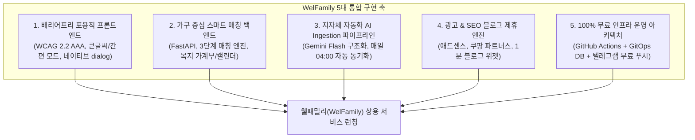
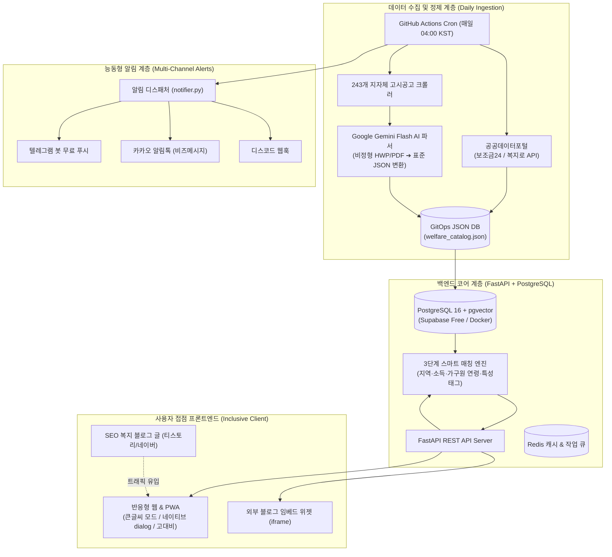

# 10. 웰패밀리(WelFamily) 종합 서비스 구현 계획서 (Master Service Implementation Plan)

## 1. 프로젝트 비전 및 통합 개요 (Executive Summary)

**웰패밀리(WelFamily)**는 정부 및 전국 243개 지자체의 방대한 복지·지원금 정보를 가족 단위로 통합 분석하고, 조건에 부합하는 정책을 능동적으로 찾아 알려주는 **AI 기반 거브테크(GovTech) 맞춤형 복지 플랫폼**입니다.

지금까지 조사·기획된 5대 핵심 축(시장 분석, 서비스 기획, 무료 인프라 파이프라인, 광고/블로그 연계, 배리어프리 포용적 디자인)을 하나로 엮어, **실제 상용 배포 및 운영이 가능한 종합 구현 계획(Master Plan)**을 수립합니다.



---

## 2. 전체 시스템 엔드투엔드 아키텍처 (End-to-End System Architecture)



---

## 3. 핵심 모듈별 구현 상세 명세 (Detailed Module Specifications)

### 3.1 모듈 1: 배리어프리 포용적 프론트엔드 개편
- **목표**: 정보 취약계층(고령자, 시각/지체 장애인, 다문화 가정)이 100% 장벽 없이 사용할 수 있는 웹 표준 준수.
- **주요 구현 항목**:
  1. **스킵 내비게이션 (`.skip-link`)**: 키보드 `Tab` 첫 입력 시 본문 직행.
  2. **어르신 맞춤 큰글씨/간편 모드 (`Senior Mode`)**: 글자 130% 확대, 1단 큰글씨 카드 전환, 터치 타깃 최소 48px 확보.
  3. **네이티브 `<dialog>` 표준 전환**: 비표준 `div` 팝업 제거, `showModal()` 호출 및 `overscroll-behavior: contain`으로 배경 스크롤 체이닝 원천 방지.
  4. **시각장애인용 ARIA Live Regions**: 조건 변경 시 `aria-live="polite"`로 계산 결과 실시간 음성 낭독.
  5. **WCAG 2.2 AA 명도 대비**: 텍스트 대비 4.5:1 이상, Windows 고대비 모드(`forced-colors: active`) 지원.

### 3.2 모듈 2: 백엔드 API 서버 & 3단계 매칭 엔진
- **목표**: 가구 프로필을 기반으로 50ms 이내에 연간 수혜액과 추천 혜택을 산출하는 비동기 API.
- **주요 구현 항목**:
  1. **도메인 계층화 (FastAPI)**: `auth`, `households`, `policies`, `matching`, `widgets`.
  2. **3단계 하이브리드 매칭 알고리즘**:
     - 1단계: 행정동 코드(지역) 및 소득인정액 상한 하드 필터링.
     - 2단계: 가구원별 생년월일/월령 기반 대상 연령 판별.
     - 3단계: 가구 특성 태그(신혼, 영유아, 다자녀, 무주택) 교집합 가중치 점수화.
  3. **가계부 & 캘린더 시뮬레이터**: 매월 25일 정기 입금액 및 마감 D-Day 타임라인 JSON 제공.
  4. **카카오 간편 로그인(OAuth 2.0) & JWT 인증**: 모바일 원클릭 인증 및 모의 테스트 계정 지원.

### 3.3 모듈 3: 지자체 자동화 AI Ingestion 파이프라인
- **목표**: 매일 새벽 04:00 KST 사람의 개입 없이 243개 지자체의 최신 공고를 표준화하고 마감일을 추적.
- **주요 구현 항목**:
  1. **보조금24 / 복지로 API 수집기**: 변경된 공공서비스 목록 일괄 동기화.
  2. **비정형 문서 AI 정제 (Gemini Flash 무료 티어)**: 복잡한 지자체 HWP/PDF 공고문을 3줄 요약, 구비서류, 자격조건 JSON으로 자동 변환.
  3. **GitOps 데이터베이스 자동 커밋**: GitHub Actions가 `data/welfare_catalog.json`을 자동 갱신하고 버전 관리.

### 3.4 모듈 4: 광고 및 블로그 제휴 마케팅 엔진
- **목표**: 검색 트래픽 유입 및 지속 가능한 수익 창출.
- **주요 구현 항목**:
  1. **SEO 블로그 자동 생성기 (`scripts/blog_generator.py`)**: 구글 애드센스 인아티클 광고 코드와 쿠팡 파트너스/이사 제휴 박스가 포함된 Markdown 포스팅 자동 발행.
  2. **블로그 임베드용 1분 복지 계산기 위젯 (`prototype/widget.html`)**: 외부 블로거가 포스팅에 복사해 넣을 수 있는 반응형 위젯 배포.
  3. **인앱 맥락 맞춤형 제휴 배너**: 상세 모달 내 이사견적 비교(CPA ₩15,000~₩30,000) 및 쿠팡 파트너스 연계.

---

## 4. 4단계 실행 스프린트 및 WBS (Work Breakdown Structure)

```
[ Sprint 1: 프론트엔드 배리어프리 전면 개편 ] ──────────▶ [ 소요 기간: 1~2일 ]
  • 본문 바로가기 스킵링크 및 시맨틱 랜드마크(header, nav, main, footer) 적용
  • 어르신 맞춤 큰글씨/간편 모드(Senior Mode) 및 글자 확대(100%/120%/140%) 구현
  • 네이티브 <dialog> 모달 전환 및 overscroll-behavior 스크롤 체이닝 차단
  • 스크린리더 음성 낭독(aria-live="polite") 및 WCAG 2.2 AA 4.5:1 고대비 색상 개선

[ Sprint 2: 백엔드 코어 구축 & 3단계 매칭 엔진 ] ────────▶ [ 소요 기간: 2~3일 ]
  • FastAPI 프로젝트 뼈대 구성 (core, models, schemas, services, api/v1)
  • PostgreSQL 16 비동기 ORM 모델 (User, Household, Member, Policy, MatchedBenefit)
  • 3단계 가구 스마트 매칭 엔진(matching_engine.py) 및 연간 수혜액 환산 로직
  • 가구 프로필 관리, 복지 정책 탐색, 캘린더 타임라인 REST API 완성

[ Sprint 3: 비동기 데이터 파이프라인 & 무료 알림 고도화 ] ──▶ [ 소요 기간: 1~2일 ]
  • GitHub Actions 일일 04:00 자동 수집 워크플로우(welfare_sync.yml) 연동
  • 텔레그램 봇, 디스코드 웹훅, 카카오 알림톡 멀티채널 디스패처 완성
  • 지자체 비정형 공고의 Gemini Flash AI 스키마 정규화 자동화

[ Sprint 4: 블로그 위젯 배포, 종합 검증 & 런칭 ] ───────▶ [ 소요 기간: 1일 ]
  • 외부 블로그용 1분 복지 계산기 위젯(widget.html) 배포 및 클릭 트래킹
  • 자동 생성된 16개 SEO 마크다운 기사(blog_posts/) 연동 점검
  • Pytest 단위/통합 테스트, 웹 접근성 KWCAG 2.2 전수 검증, GitHub Pages 배포
```

---

## 5. 종합 검증 및 품질 보증 (QA Strategy)

1. **웹 접근성(A11y) 검증**:
   - `Tab` 키만을 사용한 무(無)마우스 전 기능 제어 및 포커스 링 시인성 검증.
   - Mac VoiceOver / Windows NVDA 화면 낭독기를 활용한 실시간 음성 안내 테스트.
   - 200% 줌 확대 시 레이아웃 깨짐 없는 반응형 동작 검증.
2. **매칭 알고리즘 정밀도 검증**:
   - 페르소나별 단위 테스트(신혼부부+영유아 ➔ 540만 원, 청년 1인 ➔ 280만 원, 다자녀 ➔ 892만 원) 일치율 100% 확인.
3. **무료 인프라 안정성 검증**:
   - GitHub Actions 크론 워크플로우의 정상 종료(Exit code 0) 및 자동 Git 커밋 확인.
   - 외부 API(보조금24) 장애 시에도 로컬 캐시를 통한 무중단 서비스 제공(Fault-Tolerance) 확인.
